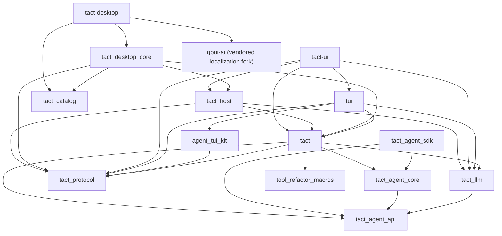
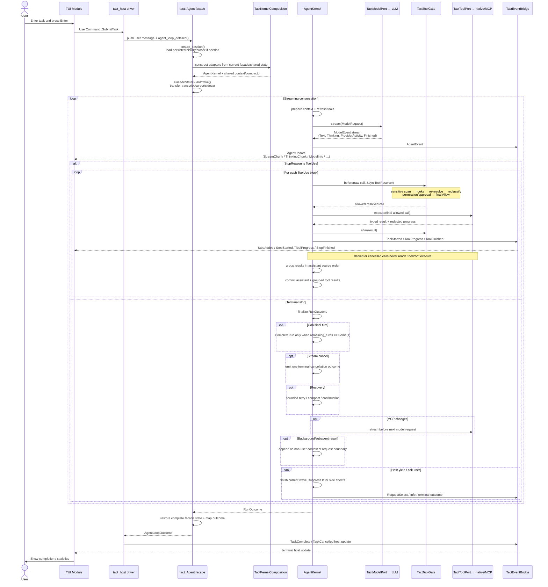
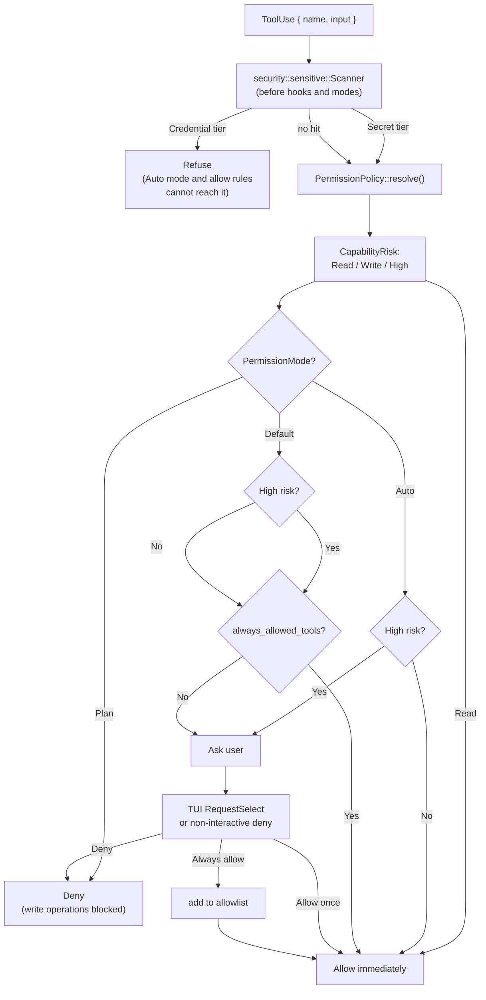
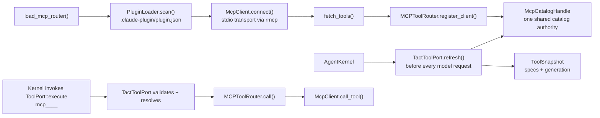
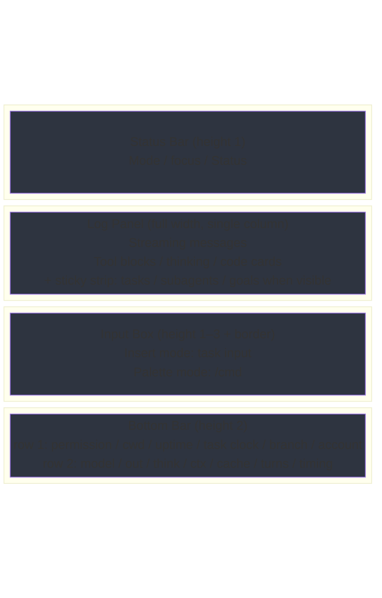
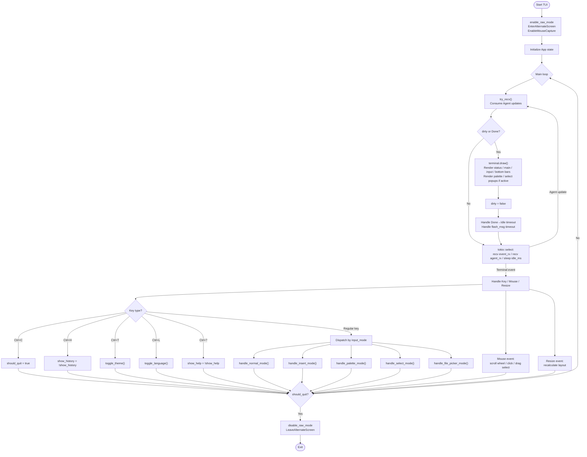
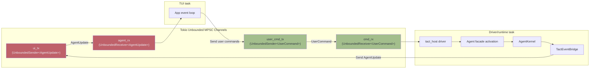
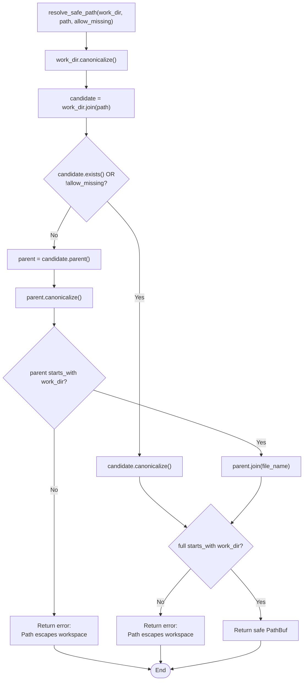

# Architecture & Flow

This document describes the overall architecture, core data flow, and terminal UI layout of `tact` using Mermaid diagrams. It reflects the current implementation rather than the original MVP design.

For detailed state-machine diagrams (TUI status, input mode, task lifecycle, permissions, hooks, etc.), see [`docs/state_machines.md`](./docs/state_machines.md). For the TUI rendering architecture (layout, log panel, popups), see [`docs/tui_rendering.md`](./docs/tui_rendering.md). For tool invocation UI (3-tier blocks, concurrent active tools, popups), see [`docs/tool_rendering.md`](./docs/tool_rendering.md).

---

## 0. Workspace Structure

This project is a Cargo Workspace containing the following crates:

| Directory | Package | Version | Responsibility |
|---|---|---|---|
| `crates/protocol` | `tact_protocol` | `2.0.0` (workspace) | Host/TUI wire types: `AgentUpdate`, `UserCommand`, `PlanStep`, `StepResult`, `StepStatus`, `ModelCallParams`, `BalanceInfo`. Its `Agent` module is legacy and is not part of the runtime path. |
| `crates/agent_api` | `tact_agent_api` | `2.0.0` (workspace) | Provider-neutral contracts for state, model streams, context, tools, gates, transcript/usage persistence, and events. No product or infrastructure implementation lives here. |
| `crates/agent_core` | `tact_agent_core` | `2.0.0` (workspace) | Bounded, provider-neutral agent kernel. `AgentKernel::run` owns one activation over injected `KernelDeps`; it has no SQLite, MCP transport, provider SDK, or TUI dependency. |
| `crates/agent_sdk` | `tact_agent_sdk` | `2.0.0` (workspace) | Ergonomic SDK facade over the neutral API and kernel: safe defaults, static tool composition, session state ownership, cancellation, and optional tracing telemetry. It has no product, provider HTTP, MCP, storage, or UI dependency. |
| `crates/tui` | `tui` | `0.1.0` (local) | Terminal UI built with `ratatui`. |
| `crates/agent_tui_kit` | `agent_tui_kit` | `0.1.0` (local) | Reusable host-protocol rendering kit for thinking/tool/log/popup widgets. |
| `crates/tact` | `tact` | `2.0.0` (workspace) | Product composition root and compatibility facade: tool router, MCP client, hooks, permissions, prompt/compaction policy, persistence adapters, and kernel wiring. |
| `crates/tact_host` | `tact_host` | `2.0.0` (workspace) | UI-independent host services: session bootstrap/locking, command loop, Goal runner, account polling, permission mapping, and input normalization. |
| `crates/catalog` | `tact_catalog` | `2.0.0` (workspace) | Frontend-neutral slash/CLI/setting command catalog, localization, canonical action IDs, and fuzzy matching shared by the TUI and desktop. |
| `crates/desktop_core` | `tact_desktop_core` | `2.0.0` (workspace) | GPUI-free desktop controller, transcript reducer, typed snapshots, project/session catalog, desktop settings, and host-session orchestration. |
| `crates/desktop` | `tact-desktop` | `2.0.0` (workspace) | Native GPUI desktop shell for macOS, Windows, and Linux. Thin UI over `tact_desktop_core` and `tact_catalog`, with gpui-ai/gpui-component leaf surfaces. |
| `crates/tact-ui` | `tact-ui` | `2.0.0` (workspace) | TUI adapter and CLI: terminal rendering/input plus headless CLI, consuming `tact_host` for shared orchestration. |
| `crates/tact_llm` | `tact_llm` | `2.0.0` (workspace) | Stable provider SDK and `tact_agent_api::ModelPort` implementation. `core` exposes the facade, builder, endpoint/limit/auth types, and a lazy stream; protocol adapters are feature-isolated behind `anthropic`, `openai-chat`, and `openai-responses`. |
| `crates/tool_refactor_macros` | `tool_refactor_macros` | `2.0.0` (workspace) | Proc-macro `#[tool]` that generates `Tool` trait implementations from async functions. |

Dependency graph:



`tact_agent_api` defines ports; `tact_agent_core` runs the control loop; `tact`
implements the ports with product adapters and constructs `KernelDeps`.
`tact_agent_sdk` is an optional embedder-facing facade; the product does not
depend on it, so it cannot drag product or provider code into an SDK host.
"Plugin style" here means **constructor injection and static composition**:
capabilities implement traits and are wired once at the composition root. It
does **not** mean a runtime plugin trait, registry, plugin id, install lifecycle,
or dynamic loader.

SDK hosts provide a model adapter (for example by adding `tact_llm` to their own
crate), then compose optional tools and policies through `AgentBuilder`.
`AgentSession` owns one `AgentState`; the kernel stays stateless across
activations. The default transcript and usage sinks retain no durable rows;
hosts inject persistence when needed.

The provider SDK's stable path is `provider constructor -> ProviderBuilder ->
Provider: ModelPort`. Built-in constructors have endpoint defaults; an
explicit `base_url` changes the endpoint without changing policy. `build` is
synchronous and does not resolve refreshable credentials or perform network IO.
Streaming is lazy, cancellation-first, and single-terminal. Product turns keep
one immutable activation snapshot and use `Provider::with_session_id` for
subagents so a child never inherits the parent's session header.

Binaries produced by `crates/tact-ui`:

| Binary | Source | Mode |
|---|---|---|
| `tact-ui` | `crates/tact-ui/` | Interactive TUI by default; `headless` subcommand for CI / non-interactive |
| `tact-desktop` | `crates/desktop/` | Native GPUI desktop app; packaged for macOS, Windows, and Linux |

`tact-ui` crate layout: `main.rs` (dispatch), `interactive.rs`, `headless.rs`, and
the terminal-specific `headless_session.rs` test harness and `sessions.rs`
printer. Shared session, driver, Goal, account, permission, and input logic
lives in `crates/tact_host`.

---

## 1. Module Architecture

```mermaid
flowchart TB
    subgraph bins["Binary entry points"]
        B1["tact-ui<br/>crates/tact-ui/"]
    end

    subgraph host["tact_host — frontend-neutral orchestration"]
        DRV["driver.rs<br/>command routing + TaskComplete"]
    end

    subgraph kernel_contracts["tact_agent_api — neutral contracts"]
        API["AgentState / RunInput<br/>ModelPort / ToolPort / ToolGate<br/>ContextPolicy / TranscriptStore<br/>UsageSink / EventPort"]
    end

    subgraph kernel["tact_agent_core — bounded runtime"]
        K["AgentKernel::run / compact"]
        KD["KernelDeps<br/>required ports + ordered observers"]
        K --> KD
    end

    subgraph sdk["tact_agent_sdk — embedder facade"]
        S["AgentBuilder / Agent / AgentSession"]
        TS["ToolSet\nstatic ToolHandler composition"]
        TE["optional tracing wrappers"]
        S --> TS
        S --> TE
    end

    subgraph facade["tact — composition root + compatibility facade"]
        A["Agent + AgentRuntime<br/>public facade/state authority"]
        FS["FacadeStateGuard<br/>activation transfer/restore"]
        C["TactKernelComposition<br/>TactKernelComposition::new()"]
        CC["CancelController<br/>session token + ActivationCancel"]
        V["TactActivationView<br/>read-only LoopState"]
        A --> FS
        A --> CC
        FS --> C
        C --> K
        C --> V
    S --> K
    TE -. no global subscriber .-> S
    end

    subgraph adapters["tact/src/runtime — capability adapters"]
        MA["TactModelPort"]
        TA["TactToolPort"]
        GA["TactToolGate"]
        CA["TactContextPolicy + TactCompactor"]
        SA["SqliteTranscriptStore<br/>SqliteUsageSink<br/>Noop variants"]
        EB["TactEventBridge<br/>AgentEvent → AgentUpdate"]
    end

    subgraph submods["tact/src/ — product services"]
        TOOL["tool/<br/>Tool trait, ToolRouter, registry.rs, 40+ tools"]
        PERM["permission/<br/>CapabilityRisk, PermissionManager"]
        HOOK["hook/<br/>lifecycle hooks + shared queues"]
        MCP["mcp/<br/>PluginLoader, McpClient, McpCatalogHandle"]
        LSP["lsp/<br/>LspClient, LspManager"]
        COMP["compact/<br/>compaction policy + state"]
        STORE["store/<br/>StoreRoot, Store, CollectionStore"]
        TASK["task/<br/>persistent task manager"]
        TEAM["team.rs<br/>teammate roster + inbox"]
        BG["background.rs<br/>async shell tasks"]
        MEM["memory/<br/>persistent user/project memory"]
        SKILL["skill/<br/>SKILL.md registry"]
        WT["worktree/<br/>git worktree lanes"]
        REC["recovery.rs<br/>transport/prompt-too-large recovery"]
        STATS["stats.rs<br/>session statistics"]
        CFG["config.rs<br/>CLI/TOML config"]
        PROMPT["prompt/<br/>system prompt templates"]
    end

    subgraph llm["tact_llm — provider implementation"]
        L["Anthropic / OpenAI / DeepSeek / Kimi<br/>ModelEvent streams"]
    end

    subgraph protocol["tact_protocol — host protocol"]
        UPD["AgentUpdate enum"]
        CMD["UserCommand enum"]
        STEP["PlanStep / StepResult"]
    end

    subgraph tui_crate["tui crate — Terminal UI"]
        T["lib.rs<br/>event loop"]
        TH["handlers/<br/>mode-specific key handling"]
        TR["render/<br/>panel rendering"]
        TS["state/<br/>App state"]
        TT["theme.rs<br/>11 color themes"]
        TI18N["i18n.rs<br/>EN / 中文"]
        TW["widgets/<br/>history, select popups"]
    end

    B1 --> DRV
    DRV --> A
    DRV --> T
    T -- UserCommand --> DRV
    EB -- AgentUpdate --> UPD
    UPD -- update channel --> T

    API -. contracts .-> KD
    KD --> MA
    KD --> TA
    KD --> GA
    KD --> CA
    KD --> SA
    KD --> EB

    MA --> L
    L --> API
    TA --> TOOL
    TA --> MCP
    GA --> PERM
    GA --> HOOK
    CA --> COMP
    CA --> PROMPT
    SA --> STORE
    V --> HOOK
    V --> PERM

    TOOL --> TASK
    TOOL --> TEAM
    TOOL --> BG
    TOOL --> CRON
    TOOL --> MEM
    TOOL --> SKILL
    TOOL --> WT
    TOOL --> STORE

    T --> TH
    T --> TR
    T --> TS
    TR --> TS
    TH --> TS
    TS --> TT
    TS --> TI18N
    TS --> TW
```



`AgentUpdate` is the host/TUI protocol, not a kernel type. Providers emit
`ModelEvent`; the kernel emits `AgentEvent`; `TactEventBridge` is the only
translation into `AgentUpdate`. The `tact-ui` driver owns `TaskComplete`.
Injected context and hosted provider activity stay on their typed non-user
channels and are never fabricated as a user turn or client tool call.
`tact_protocol::update_channel` separates bounded advisory progress from
reliable ordered terminal updates; the raw unbounded sender remains a
compatibility path for small embedders and tests.

---

## 2. Agent Task Execution Flow

The runtime no longer pre-generates a fixed JSON plan. `tact::Agent` is the
compatibility facade; each bounded activation enters the provider-neutral
kernel, which owns the streaming/tool loop over injected ports.



The provider emits `ModelEvent`, the kernel emits `AgentEvent`, and only the
product-owned `TactEventBridge` emits `AgentUpdate`. `TaskComplete` remains
driver-owned.

Key `AgentUpdate` variants used today:

| Variant | Meaning |
|---|---|
| `PlanGenerated(Vec<PlanStep>)` | **Deprecated (0.19.0).** TUI handler retained; agent emits `StepAdded` / `StepStarted` instead. |
| `NeedApproval(...)` | **Deprecated (0.19.0).** TUI handler retained; agent uses `RequestSelect` instead. |
| `StepAdded(PlanStep)` | A new tool-use step is appended to the internal `app.plan.steps` store (`description` = `tool (arg_summary)`; full args in `PlanStep.args`). There is no dedicated plan panel; does not add a log line. |
| `StepStarted(usize, tool_id, tool_name, arg_summary)` | Step `idx` has begun; TUI renders a running tool block with truncated title args. |
| `ToolProgress { tool_id, chunks }` | Informational ordered stdout/stderr progress for an active tool. It does not close thinking/loading gates or finalize the step; unknown or late IDs are ignored. |
| `StepFinished(usize, tool_id, StepResult)` | Step succeeded — summary, detail, duration, optional `permission_label`, optional `arg_full` for popups. |
| `StepFailed(usize, tool_id, String)` | Step failed with error message. |
| `RequestSelect { prompt, options, respond }` | Ask the user to pick an option. |
| `StreamChunk(String)` | Streaming assistant text fragment. |
| `ThinkingChunk(Started \| Delta(String) \| Finished)` | Streaming reasoning lifecycle. |
| `ModelInfo(ModelCallParams)` | Model name, max tokens, thinking budget. |
| `TokenUsage { ... }` | Prompt/completion/cache token counts. |
| `Balance(BalanceInfo)` | DeepSeek / Kimi account balance (where available). |
| `Info(String)` | Informational notice. |
| `TaskComplete(String)` | The entire task finished. |
| `Error(AgentErrorKind)` | Classified error. |

---

## 3. Permission System

Every tool call is classified by risk and checked against the active permission mode.



| Mode | Behavior |
|---|---|
| `default` | Read-only tools allowed; writes ask once; high-risk asks until an explicit allow covers that exact tool and input. |
| `plan` | Read-only only; all writes denied (useful for review-first workflows). |
| `auto` | Every capability auto-approved, High included (matches `bypassPermissions`, not `acceptEdits`); the pre-`check` credential guard still refuses secret reads. |

Special cases:

- `read_file` and tools whose names start with `read`, `list`, `get`, `show`, `search`, `query`, `inspect`, or `find` are classified as `Read`.
- `spawn_subagent` is always `High` because it spawns a sub-agent with full filesystem/shell access.
- `bash` commands containing `rm -rf`, `sudo`, `shutdown`, or `reboot` are always `High`.
- Simple read-only bash commands (`ls`, `cat`, `git status`, etc.) are classified as `Read` — **unless** the command names a credential path, which is checked first. The safelist proves the program cannot write, not that its output is safe to publish: `cat ~/.ssh/id_ed25519` is provably read-only and reads a private key.
- Read tools whose **target** is sensitive escalate: `.env` is not `src/main.rs`. `PermissionPolicy::{ReadPath, WritePath, PatchPaths}` carry that, so the target — not just the verb — decides the risk.

Live and final result text is redacted in `TactToolPort`; hook-rewritten visible
output is redacted again in `TactToolGate` before it can reach the transcript or
host. The kernel never receives an unredacted hook rewrite. See
[Ch 10 §12](book/10_chapter_permission_zh.html#12-敏感路径与密钥脱敏).

---

## 4. Hook Engine

Hooks are registered on the `Agent`, but a kernel activation invokes them
through product-owned adapters with a borrowed, read-only
`TactActivationView` (`LoopState`), never `&mut Agent` or a writable transcript.
Tact maps fifteen lifecycle events; the full table is in
[Ch 9](book/09_chapter_hook_zh.html). The mutable ones:

| Hook type | When | Can mutate | Can veto |
|---|---|---|---|
| `SessionStart` | Once per session, on the first turn rather than at startup — after any pre-turn compaction, before that turn's user message; re-run with `source: "compact"` after a compaction | `&mut SessionStartContext` (appends injected context) | Yes — `Block` skips the turn (Codex `continue: false`) |
| `PreToolUse` | Before each tool execution | `ToolUse` input; appends injected context | Yes |
| `PostToolUse` | After each tool execution | `ToolResult` content; appends injected context | Yes |

A hook returns `HookControl::Continue` or `HookControl::Block(reason)`. The first `Block` short-circuits the chain.

---

## 5. MCP Integration

`tact` is a native MCP client. External tools are exposed as namespaced tool names.



MCP tool naming convention: `mcp__<server_name>__<tool_name>`. Example: `mcp__filesystem__read_file`.
`ToolGate` sees only `&dyn ToolResolver`; approval cannot execute an MCP tool.
The kernel is the sole caller of `ToolPort::execute`.

---

## 5.5 System Prompt & Dynamic Context

The runtime builds the system prompt via `SystemPrompt` (Tera template in `crates/tact/src/prompt/`) plus injected blocks:

| Block | Source |
|---|---|
| Role / guidelines / constraints | Static template |
| Skills | `skill_registry.describe_available()` (name/description only; full body via `load_skill` or TUI `/skill`) |
| Memory | `~/.tact/projects/<repo>/memory/*.md` via `MemoryManager` (one directory per git repository, shared across its worktrees). Only `MEMORY.md` is injected; bodies via `load_memory` |
| CLAUDE.md | `~/.claude/CLAUDE.md`, project `CLAUDE.md`, optional subdir — **cached once per session** |
| AGENTS.md | project `AGENTS.md` (and cwd if it differs), injected via `additional` — **cached once per session** |
| **Dynamic context** | `load_dynamic_context()` — date, workdir, model, platform, **Project structure** |

### Project structure snapshot

`load_dynamic_context()` calls `snapshot_dir(workdir, max_items)` once per session and caches the result in `AgentRuntime.cached_dir_snapshot` for stable KV-cache prefixes.

| Setting | Config key / CLI | Default | Description |
|---|---|---|---|
| Snapshot size | `agent.snapshot_max_items` / `--snapshot-max-items` | `80` | Max files/dirs in the snapshot (truncated after sort) |
| Walk depth | `4` | Max directory depth from project root |

Snapshot behavior (language-agnostic, works for any repo layout):

1. **Prune ignored dirs at traversal time** via `WalkDir::filter_entry` (`target`, `node_modules`, `.git`, dot-dirs except `.gitignore` / `.env.example`, etc.)
2. **Sort** by depth (shallow first), then directories before files, then path name
3. **Truncate** to `max_items`, then group by parent directory for display

`AGENTS.md` provides a stable hand-maintained crate map; the runtime snapshot supplements it with the current working tree.

For a curated map without scanning, prefer keeping `AGENTS.md` up to date — the snapshot is a best-effort overview, not a full tree listing.

---

## 6. Context Compaction

When the conversation approaches the model context window (`agent.model_context_window`, default **200_000 tokens**), `TactContextPolicy` proposes a typed compaction and the kernel owns the commit barrier:

1. Micro compaction replaces old tool-result blocks longer than 120 chars with a stub, keeping the 12 most recent results intact.
2. If auto compaction fires at 80% of the model window, the product policy summarizes a window-aware recent slice with bounded retries and response validation, rebuilds context as retained real-user turns plus a handoff summary, and validates the complete rebuilt request. The kernel persists the returned replacement through `TranscriptStore`; there is no adapter-side transcript write. ASCII is estimated at roughly four characters per token and non-ASCII at one character per token. Retained users are capped at 20k estimated tokens and reduced to reserve max output, system/tool/summary input, and 20% window headroom; oversized images become text omission markers rather than truncated base64.
3. For OpenAI `protocol = "responses"` providers this local summary path is **not** used: ordinary requests carry `context_management` with the resolved compact threshold, and `TactCompactor`/`TactModelPort` call the native `POST /responses/compact` endpoint, replacing the opaque protocol cursor (never the logical transcript). Endpoints without native compaction are unsupported — no local-summary fallback. See [Ch 5](./book/05_chapter_compact_zh.html).
4. Large successful native and MCP outputs are persisted to `<workdir>/.tact/tool-results/<tool_use_id>.txt` instead of being kept verbatim in context. Transcript and tool-result directories each retain the 100 newest files.

The TUI bottom-bar row 2 shows the same window as a usage meter (`used / model_context_window`).

Recovery mechanisms inside `AgentKernel::run_inner`:

| Failure | Action |
|---|---|
| Prompt too long | Retry after a typed overflow compaction (up to `MAX_RECOVERY_ATTEMPTS`). |
| Transient transport error | Exponential backoff retry. |
| `max_tokens` truncation with pending tools | Execute pending tools, then continue with a continuation prompt. |

Recovery counters are carried in `RunOutcome.recovery`; the facade copies them
into `AgentRuntime.recovery_state` before returning. Compaction calls and
transport retries do not consume main-loop turns; a context-overflow retry does.

---

## 7. Sub-agents, Team, Tasks, Worktrees

| Feature | Module | Description |
|---|---|---|
| `spawn_subagent` tool | `tool/subagent.rs` | Spawns an isolated sub-agent with a restricted toolset (`bash`, `read_file`, `write_file`, `edit_file`, `sleep`). |
| Persistent tasks | `task/` | `TaskManager` stores task records with status and dependency tracking under `.tact/tasks/`. |
| Teammates | `team.rs` | Named agents with roles and an inbox supporting point-to-point messages, broadcasts, `plan_approval`, and shutdown protocols. |
| Worktrees | `worktree/` | Git worktree isolation: `create`, `list`, `status`, `run`, `events`. Metadata stored under `.tact/worktrees/`. |
| Background tasks | `background.rs` | Async shell commands with polling via `background_run` / `check_background`. |
| Memory | `memory/` | One Markdown directory per git repository (`~/.tact/projects/<repo>/memory/`), files with YAML frontmatter (`user`, `feedback`, `project`, `reference`, `modified`). Only the `MEMORY.md` index is injected; bodies via `load_memory`. |
| Skills | `skill/` | `SKILL.md` under `<workdir>/.tact/skills/`, `~/.tact/skills/`, `~/.agents/skills/`, `.claude/skills/`, plus optional `[agent].skill_dirs`; **summaries** in the system prompt; full body via `load_skill` or TUI slash (`<skill>` wrap). |
| Durable goals | `goal/` | `GoalManager` + `GoalRunner` supervise cross-turn objectives with SQLite-persisted state, bounded activations (turn/tool/wall-clock budgets), lease fencing, evidence-based verification, and `/goal` commands. Tasks optionally link to a Goal via nullable `goal_id`. See [Ch 28](./book/28_chapter_goal_zh.html). |

---

## 8. TUI Render Layout



### Overlays (popup panels)


---

## 9. Event Loop Flow



### Normal-mode shortcuts

| Key | Action |
|---|---|
| `j` / `k` | Scroll log. |
| `g` / `G` | Jump to top / bottom of log. |
| `i` / `Enter` | Enter insert mode. |
| `/` | Open command palette. |
| `y` | Copy selection / last message / approve if waiting. |
| `Y` | Copy last code block. |
| `V` | Open closest code-block popup. |
| `t` | Open closest thinking popup. |
| `c` | Cancel current task. |
| `q` | Quit. |
| `Esc` | Reject approval / clear selection. |

### Global shortcuts (any mode)

| Key | Action |
|---|---|
| `Ctrl+C` | Quit. |
| `Ctrl+H` | Toggle history overlay. |
| `Ctrl+T` | Toggle theme. |
| `Ctrl+L` | Toggle language (EN / 中文). |
| `Ctrl+?` | Toggle help overlay. |

---

## 10. Channel Communication Architecture



`UserCommand` variants:

| Variant | Meaning |
|---|---|
| `SubmitTask(String)` | Submit a new natural-language task. |
| `Cancel` | Cancel the current task. |
| `QueryBalance` | Query DeepSeek / Kimi account balance. |

---

## 11. Sandbox Safe Path Resolution

The runtime uses `resolve_safe_path(work_dir, path, allow_missing)` in `crates/tact/src/tool/path.rs`.



This guard is unrelated to the OS-level **execution** sandbox (bubblewrap) of
[Bash Sandbox](./book/27_chapter_sandbox_zh.html): `resolve_safe_path` bounds the
in-process file tools' *paths*, while the execution sandbox bounds what an
approved `bash` command can *reach* (`crates/tact/src/sandbox/`).

---

## 12. Configuration Loading Order

`tact::config::init()` merges configuration from (highest priority first):

1. CLI arguments (`--model`, `--permission-mode`, positional prompt, etc.).
2. TOML config files: `<project>/.tact/config.toml`, `<project>/config.toml`, `~/.tact/config.toml`, or `--config`.

Resolved settings are stored in a process-global `ResolvedConfig` (via `config::install()`) and accessed at runtime through `config::settings()`. LLM provider credentials are passed to `tact_llm::init_provider()` at startup.

LLM provider selection (set in `[llm]` or via CLI):

| `provider` | Required fields |
|---|---|
| `anthropic` | `api_key`, `base_url` |
| `openai` | `api_key`; optional `base_url` (defaults to OpenAI) |
| `kimi` | `api_key`; optional `base_url` (defaults to Kimi Code API) |

---

## 13. `#[tool]` Proc Macro & Self-Described Native Tools

The `tool_refactor_macros` crate provides the `#[tool]` attribute macro. Starting from Task 5 of the
tool-metadata-refactor, the macro uses the bare form (no `name`/`description` arguments).

Each native tool handler declares a sibling `UPPER_SNAKE_HANDLER_METADATA` constant of type
`ToolMetadata`, which the proc macro references via `&#metadata_ident` in the generated `Tool` impl.

### Metadata flow

```
LLM name → ToolRouter::resolve → RegisteredTool(handler + ToolMetadata)
          → permission/resource/presentation/output policies
          → ToolCallResult(content + typed effects)
```

- **External names** remain stable strings used for LLM-facing tool specs and
  `always_allowed_tools` entries. Rust enum variant names are never serialized.
- **Permission** is derived from `PermissionPolicy` (Read/Write/High/ShellCommand).
- **Resources** come from `ResourcePolicy` (ReadPath/WritePath/Barrier/SharedState/PatchFiles).
- **Presentation** converts to protocol `ToolPresentationInfo` via `ToolPresentation::to_protocol()`.
- **Output policy** (`PersistLargeOutput` / `KeepInline`) controls post-execution persistence.
- **Argument summaries** use `ArgumentSummaryPolicy` for tool-card formatting.
- **Tool effects** are typed (`ToolEffect::CompactHistory { focus }`) and applied only on success.
- **MCP tools** are parsed at the adapter boundary (`mcp__{server}__{tool}`) and receive
  conservative generic defaults for presentation, resources, and permission.
- **Unknown tools** fail closed before execution — no native privileges leak through.

Handlers can be either:

- **Pure functions**: arguments are plain types, wrapped into a generated input struct.
- **Stateful handlers**: first argument is `ToolContext`, followed by a single deserializable input struct.

---

## 14. What Changed Since the Original Architecture

If you are reading older branches or notes, the following major evolutions have happened:

- The plan-then-execute model (`generate_plan()` → sequential `execute_step()`) was first replaced by a streaming facade loop, then by the bounded `tact_agent_core::AgentKernel`; `tact::Agent` remains the compatibility facade.
- Neutral contracts live in `tact_agent_api`; provider adapters implement `ModelPort`; product adapters in `crates/tact/src/runtime/` implement tool, gate, context, transcript, usage, and event ports.
- The activation selector, `agent/tool_dispatch.rs`, legacy stream/compaction helpers, and `LegacyModelBridge` were deleted after parity. `tool_schedule.rs` retains only the product `ToolResources` contract and `LoopState` is a read-only activation view.
- Business tools live in `crates/tact/src/tool/`; the legacy `crates/tools` Sandbox crate was removed.
- The runtime gained native support for MCP, hooks, permissions, context compaction, recovery, sub-agents, teammates, worktrees, memory, and skills.
- `tact_protocol::Agent` is legacy code and is no longer used by the main binaries.
- The TUI gained streaming output, diff/code/thinking popups, a command palette, mouse support, themes, and internationalization.
- **Tool log blocks** — 3-tier layout (title + meta + detail card), concurrent active tools, live running elapsed time, and a fixed five-row live tail for active `bash` calls. Progress is keyed by `tool_id`; stderr uses warning styling, active output opens in the detail popup, and updates preserve bottom pinning or an explicit visual scroll position (`log_scroll.visual_top`).
- **CLI / host split** — `tact_host` owns UI-independent session, command,
  Goal, account, permission, and input services. `tact-ui` is a terminal
  adapter (plus `headless`) over that host; desktop hosts can reuse
  `tact_host` without depending on `tui`.
- **Popups / code cards** — modal popups render without drop shadow; code block titles use plain language labels (no emoji icons).
- **Session store** — SQLite at `<workdir>/.tact/tact.db`; token usage rows optionally store serialized LLM `request_body` for debugging.
- **Dynamic context** — Project structure snapshot with pruned walk, default 80 items, session-cached for KV stability.
- **Bottom bar Cost timer** — retains last prompt duration until the next submission.

---

## 15. Related Documents

| Document | Focus |
|---|---|
| [`docs/state_machines.md`](./docs/state_machines.md) | Detailed state-machine diagrams for the TUI, tasks, background jobs, permissions, hooks, and recovery. |
| [`docs/tui_rendering.md`](./docs/tui_rendering.md) | TUI rendering architecture: layout, log panel, popups, Markdown, cells, performance optimization. |
| [`docs/tool_rendering.md`](./docs/tool_rendering.md) | Tool block design: ToolWidget → ToolCell pipeline, concurrent tools, detail cards, DiffPopup. |
| [`docs/tool_rendering.md`](./docs/tool_rendering.md) | Tool invocation UI (3-tier blocks, concurrent active tools, popups). |
| [`docs/compaction.md`](./docs/compaction.md) | Context compaction behavior and tuning. |
| [`docs/token_usage_schema.md`](./docs/token_usage_schema.md) | SQLite `token_usages` schema, cache metrics, `request_body` debug column. |
