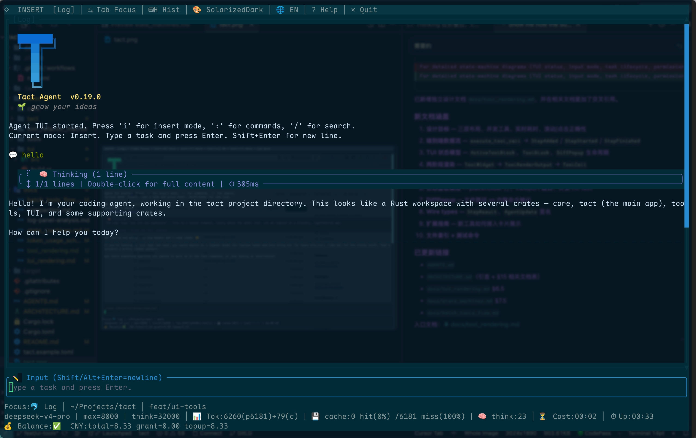

<p align="center">
  
</p>

<h1 align="center">tact</h1>

<p align="center">
  <strong>Terminal and native desktop AI coding agent. Built in Rust. MIT licensed.</strong>
</p>

<p align="center">
  <a href="#quick-start"><strong>Quick Start</strong></a> ·
  <a href="#features"><strong>Features</strong></a> ·
  <a href="#architecture"><strong>Architecture</strong></a> ·
  <a href="#configuration"><strong>Configuration</strong></a>
</p>

<p align="center">
  
  
  
  
  <a href="https://ko-fi.com/00x80">
    
  </a>
</p>

---

## What is tact?

tact is an **AI coding agent with a terminal UI and a native desktop app**. It
reads your codebase, understands your intent, and executes. It edits files,
runs commands, searches code, and coordinates with sub-agents.

- 🦀 **Written in Rust** — a terminal CLI and native desktop app, with no
  Electron or Node.js runtime
- 🏠 **Self-hosted runtime** — Tact has no hosted service and no account. The
  only traffic is the model providers, MCP servers, and transcription service
  you configure, plus GitHub when you run `tact-ui upgrade`
- 🔓 **MIT licensed** — open source
- 🧩 **Extensible** — MCP plugins, custom skills, hooks, and tool macros

```
$ tact-ui headless "Add a --verbose flag to the CLI and update the README"
```

That's it. Configure a provider, open a terminal, and prompt.

---

## Quick Start

### 1. Install

**Linux / macOS**

```bash
curl -fsSL https://raw.githubusercontent.com/rust-infra/tact/main/scripts/install.sh | bash
```

Or from a clone:

```bash
./scripts/install.sh --from-source
```

**Windows (PowerShell)**

```powershell
irm https://raw.githubusercontent.com/rust-infra/tact/main/scripts/install.ps1 | iex
```

Or from a clone:

```powershell
.\scripts\install.ps1 -FromSource
```

The installer prefers a matching GitHub release asset when one exists, otherwise
builds `tact-ui` from source (requires **Rust 1.99+** / edition 2024; installs
rustup if needed). Pass `--from-source` / `-FromSource` to skip the release
download, or `--release` / `-Release` to prefer a pre-built binary with source
fallback:

```bash
curl -fsSL https://raw.githubusercontent.com/rust-infra/tact/main/scripts/install.sh | bash -s -- --release
```

Install options:

| Platform | Flag | Meaning |
|----------|------|---------|
| Unix | `--install-dir DIR` | Install location (default: `~/.local/bin`) |
| Unix | `--system` | Install to `/usr/local/bin` |
| Unix | `--from-source` | Build from source only |
| Unix | `--release` | Prefer GitHub release, fall back to source |
| Unix | `--release-only` | Require a GitHub release (no source fallback) |
| Unix | `--git-ref REF` | Git branch or tag to clone (default: `main`) |
| Unix | `--skip-deps` | Skip OS package and rustup installation |
| Unix | `--no-modify-path` | Do not add the install dir to the shell PATH |
| Windows | `-InstallDir PATH` | Install location (default: `%USERPROFILE%\.local\bin`) |
| Windows | `-FromSource` | Build from source only |
| Windows | `-Release` | Prefer GitHub release, fall back to source |
| Windows | `-ReleaseOnly` | Require a GitHub release (no source fallback) |
| Windows | `-GitRef REF` | Git branch or tag to clone (default: `main`) |
| Windows | `-SkipDeps` | Skip rustup installation |
| Windows | `-NoModifyPath` | Do not add the install dir to the user PATH |

**Manual build from source**

Linux: install SQLite build dependencies first (required by `sqlx` / session store).
Building from source requires **Rust 1.99+** (edition 2024):

```bash
sudo apt-get update
sudo apt-get install -y libsqlite3-dev pkg-config clang libclang-dev
```

```bash
git clone https://github.com/rust-infra/tact.git
cd tact
rustup toolchain install stable   # if needed; rustc >= 1.99
cargo build --release --locked -p tact-ui
./target/release/tact-ui --help
```

### Tact Desktop

`tact-desktop` is the native GPUI frontend for macOS, Windows, and Linux. It
uses the same `tact_host` session runtime, project-local SQLite store, command
catalog, Goals, subagents, and extensions as the terminal UI.

```bash
cargo run -p tact-desktop
cargo build --release -p tact-desktop
```

The release workflow also packages `tact-ui` beside the desktop binary. Windows
and Linux ship matching desktop and CLI binaries. The macOS `.app` bundle is
signed and notarized only when the repository has the six signing secrets
(`MACOS_CERTIFICATE`, `MACOS_CERTIFICATE_PASSWORD`, `MACOS_SIGNING_IDENTITY`,
`APPLE_ID`, `APPLE_TEAM_ID`, `APPLE_APP_PASSWORD`). Without them the release
still ships, with an unsigned bundle: macOS users open it once from the
right-click **Open** menu, or run
`xattr -d com.apple.quarantine 'Tact Desktop.app'`. A partial set of secrets
fails the release and names the missing ones.

Building the desktop on Linux needs the GPUI platform libraries, which the CLI
does not:

```bash
sudo apt-get install -y libasound2-dev libfontconfig1-dev libfreetype6-dev \
  libsqlite3-dev libwayland-dev libx11-dev libxcb1-dev libxcb-render0-dev \
  libxcb-shape0-dev libxcb-xfixes0-dev libxkbcommon-dev \
  libxkbcommon-x11-dev pkg-config
```

Runtime on Linux also needs a Vulkan driver. The release build targets
`crates/tact-ui` by default; `cargo build` alone does not compile the desktop
shell because it pulls gpui into every UI rebuild.

Installing from a local checkout (the crates are not published to crates.io yet):

```bash
cargo install --path crates/tact-ui
```

**Binary releases:** bump `[workspace.package].version` in `Cargo.toml` in the
PR that changes the behaviour. A merge to `main` whose version is new is tagged
by `.github/workflows/tag.yml`, which calls `release.yml` and builds the
binaries for Linux (x86_64 / ARM64), macOS (x86_64 / ARM64), and Windows
(x86_64). A hand-pushed tag that does not match the workspace version is
rejected by `scripts/check-release-tag.py`, and `release.yml` builds nothing.

GitHub Actions (`.github/workflows/release.yml`) uploads
`tact-ui-v<version>-<target-triple>.tar.gz` / `.zip`,
`tact-desktop-v<version>-<target-triple>.tar.gz` / `.zip`, and the checksum
manifest.

### 2. Configure

Create `config.toml` in your project root (or `~/.tact/config.toml` for user-level defaults):

```toml
[llm]
provider = "anthropic"   # selects [llm.providers.anthropic]

[llm.providers.anthropic]
model = "claude-sonnet-4-20250514"
api_key = "sk-ant-..."
base_url = "https://api.anthropic.com"  # required for anthropic

[permission]
mode = "default"   # "default" | "plan" | "auto"

[agent]
model_context_window = 200000
snapshot_max_items = 120
micro_compact_enabled = false
memory_enabled = true
notifications_enabled = true

[ui]
theme = "ink"   # dark | light | solarized-dark | solarized-light | gruvbox-dark | nord | retro | kawaii | japanese | brutal | ink | ink-light | claude | claude-dark | auto

[tools]
# Bash wall-clock timeout in seconds (default: 1800; 0 disables timeout)
bash_timeout_secs = 1800
# Bash process niceness (default: 10; 0 disables)
bash_nice = 10
```

CLI flags override the config file (e.g. `--model`, `--api-key`, `--theme`).

Optional agent settings (config file or CLI):

| Setting | CLI flag | Default | Description |
|---|---|---|---|
| `snapshot_max_items` | `--snapshot-max-items` | `120` | Max entries in the system-prompt Project structure snapshot |
| `model_context_window` | `--model-context-window` | `200000` | Model context window in tokens (80% auto-compact + TUI usage meter) |
| `micro_compact_enabled` | `--no-micro-compact` | `false` | Stub old tool results before each LLM call when enabled |
| `memory_enabled` | none | `true` | Inject the `MEMORY.md` index + memory guidance and register `save_memory` / `load_memory`; `false` disables all four (files are kept) |
| `auto_memory_directory` | none | derived per repository | Override the memory directory (`~`/relative expand like `skill_dirs`) |
| `skill_dirs` | none | none | Extra skill roots, each holding `*/SKILL.md`; loaded after the built-in roots |
| `skill_body_auto_inject` | `--skill-body-auto-inject` | `false` | Put every skill body in every system prompt instead of names and descriptions |

`notifications_enabled` / `--notifications` controls desktop notifications and
is macOS-only. Other keys are documented inline in
[`config.example.toml`](./config.example.toml): the `[goal]` run budgets,
`[agent.subagent]` overrides, `[voice]`, `[tools].sandbox`, `[tools].rtk_filter`,
and `[mcp]`.

### 3. Run

```bash
# Interactive TUI (default)
tact-ui

# Headless single-shot task
tact-ui headless "Fix all clippy warnings in src/ and run cargo test"

# With specific model
tact-ui --model "claude-sonnet-4-20250514" headless "Refactor the error handling in lib.rs"

# Plan-only mode (review before execution)
tact-ui -m plan headless "Add rate limiting to the API client"
```

Top-level flags go before the subcommand. `tact-ui headless --model m` is not
accepted, and the CLI says so rather than silently ignoring the flag.

In the interactive TUI, a `/` opens the command palette. The built-in commands:

| Command | Does |
|---|---|
| `/theme` | Choose a color theme (`Ctrl+T` cycles) |
| `/model`, `/model-subagent` | Switch the model for this session, or for sub-agents |
| `/permission` | Set the permission mode |
| `/lang` | Toggle the UI language (English / 中文) |
| `/compact` | Compact the conversation now |
| `/goal` | Create, inspect, and control durable Goals (see below) |
| `/tasks-dag` | Show the task dependency graph |
| `/stats` | Session statistics |
| `/trajectory` | Open the run's trajectory ledger |
| `/background` | Background task status |
| `/balance` | Query the provider account balance (DeepSeek / Kimi) |
| `/skill` | List, reload, or run a skill |
| `/plugin`, `/mcp` | Manage plugins and marketplaces, or MCP servers |
| `/hooks`, `/hook-output` | Review command hooks; show or hide their output in the log |
| `/view-system-prompt` | Show the assembled system prompt |
| `/save`, `/history` | Save the log to a file; show task history |
| `/cancel`, `/subagent_cancel` | Cancel the running task, or one sub-agent |
| `/help`, `/quit` | Help panel; exit |

Persisted sessions can be resumed with `--session ID` or `--resume-last`; inspect
recent sessions with `--list-sessions`. Plugin and marketplace management is also
available without starting the TUI:

```bash
tact-ui plugin list
tact-ui plugin install superpowers@claude-plugins-official
tact-ui plugin uninstall superpowers
tact-ui plugin update superpowers
tact-ui plugin marketplace add owner/repository
tact-ui plugin marketplace list
tact-ui plugin reload
```

MCP servers are managed the same way — no hand-editing `mcp.json` required:

```bash
tact-ui mcp list                       # every configured server + its status
tact-ui mcp get deepwiki               # one server: transport, source, tools
tact-ui mcp add deepwiki --url https://mcp.deepwiki.com/mcp
tact-ui mcp add linear --url https://mcp.linear.app/mcp --oauth
tact-ui mcp add local --command npx --arg -y --arg some-mcp-server
tact-ui mcp login linear               # run the OAuth browser flow
tact-ui mcp logout linear              # delete the stored credentials
tact-ui mcp remove local               # delete the declaration only
```

`add`/`remove` write the project file (`.tact/.mcp.json`) by default; pass
`--user` for `~/.tact/.mcp.json` or `--force` to replace an existing
declaration. `login`/`logout` own the tokens under `~/.tact/mcp/oauth/`, and
`mcp auth` remains an alias for `mcp login`.

Command hooks from a repository, your user directory, or an installed plugin
run only after you approve them:

```bash
tact-ui hooks list                     # every hook, and whether it was reviewed
tact-ui hooks trust --all              # approve everything still pending
tact-ui hooks trust --source .tact/hooks.json
tact-ui hooks forget --all             # revoke every approval
```

Some providers gate OAuth registration on the *client name* rather than
verifying the client: Figma answers `200` for `Codex` and `403` for `Tact` with
an otherwise identical request. Tact therefore registers as
`mcp.oauth_client_name`, default `"Codex"`, so these providers work out of the
box. The trade-off is that the provider — and the OAuth consent screen — sees
`"Codex"`; the name actually used is logged and printed on failure. Set it back
to identify honestly, per config file or per server:

```toml
[mcp]
oauth_client_name = "Tact"
```

Self-upgrade is built in:

```bash
tact-ui upgrade --check   # check for a newer release without installing
tact-ui upgrade           # prompt, then upgrade to the newest release binary
tact-ui upgrade --yes     # skip the confirmation prompt
```

`tact-ui upgrade` finds the newest GitHub release that ships a binary for your
platform (asset-less tags and pre-releases are skipped), downloads it, verifies
it against the published `SHA256SUMS`, and atomically replaces the running
executable on macOS/Linux. Track a fork with `--repo owner/name` (or the
`TACT_UPGRADE_REPO` environment variable). On Windows, re-run
`scripts/install.ps1` to upgrade.

The automated release workflow intentionally publishes stable
`vMAJOR.MINOR.PATCH` tags only. SemVer prerelease and build-metadata suffixes
are rejected with an explicit error rather than being treated as publishable
desktop releases.

---

## Features

### 🧠 Intelligent Agent Loop

Multi-turn conversation loop with progressive context management:

1. **Large-output spill** — oversized tool results land on disk with a short preview in context
2. **Micro-compact (optional)** — when enabled, stub old tool results before each LLM call (keep the last 12 intact)
3. **Full compact** — for chat-completions providers, when reported or
   estimated tokens hit about 80% of `model_context_window`, on
   prompt-too-long recovery, or through a successful `compact` tool, write a
   JSONL transcript, summarize it, and rebuild context from recent user turns
   plus a handoff summary. OpenAI Responses uses provider-native compaction.
   Responses endpoints without native compaction are unsupported.

The entry path reserves the incoming user turn before push, so a large prompt cannot overflow immediately after append. Failed `compact` tool calls leave history intact.

Details: [`book/05_chapter_compact_zh.html`](./book/05_chapter_compact_zh.html), [`docs/compaction.md`](./docs/compaction.md).

### 🔧 Native Tool Set

Forty native tools cover files, shells and background processes, tasks,
sub-agents and teammates, durable Goals, memory and skills, git worktrees, and
user interaction. MCP servers add their own at runtime. The full list is under
[Built-in Tools](#built-in-tools).

In the interactive TUI, a running `bash` tool shows the last three lines of
output, and a running sub-agent shows its last eight. stdout and stderr merge
in the order Tact observes their pipe reads, with stderr styled as warning
text. Tact does not add a PTY, rewrite commands, or bypass buffering owned by
the command or pipeline. Headless mode remains final-result-only.

Two opt-in switches change what `bash` runs. `[tools].sandbox = true` wraps the
shell in bubblewrap on Linux, so third-party code an approved command pulls in
cannot write outside the workspace. `[tools].rtk_filter = true` pipes output
through [`rtk`](https://github.com/rtk-ai/rtk) when it is on `PATH`. Both are
off by default. The sandbox has no implementation outside Linux, where enabling
it runs unsandboxed and says so at startup.

### 🔐 Three Permission Modes

| Mode | Behavior |
|---|---|
| `default` | Read-only tools run without asking. Writes ask once; high-risk calls ask until an explicit allow covers that exact tool and input. |
| `plan` | Read-only tools only. Every write and high-risk call is denied. |
| `auto` | Every capability is auto-approved, high-risk included. The credential scanner still refuses secret reads. |

Read decisions come first: `read_file`, `list_*`, `get_*`, and read-only shell
commands such as `git status` never prompt. A read whose target is a sensitive
path (`.env`, a private key) is escalated instead. `spawn_subagent` is always
high-risk. Allow and deny rules live in `~/.tact/settings.json` and
`<workdir>/.tact/settings.json`, keyed on the exact tool and input. `[permission]`
in `config.toml` holds only the mode.

### 🪝 Hooks & Skills

- **Pre/Post hooks** — intercept tool calls before/after execution. Run linters, format code, log usage. Hooks also fire on session start and end. A hook from `.tact/hooks.json`, `~/.tact/hooks.json`, or an installed plugin is not registered until you approve it with `tact-ui hooks trust`, so cloning a repository cannot execute anything on its own. Editing an approved command requires approving it again.
- **Skills** — `SKILL.md` playbooks. Roots load in this order, and a later root wins on a name clash: `~/.agents/skills/` (Codex compatibility), `~/.tact/skills/`, `<workdir>/.tact/skills/`, then any `[agent].skill_dirs`. The system prompt lists names and descriptions; the full body arrives via `load_skill` or a TUI `/skill-name`. `<workdir>/.claude/skills` is not scanned.
- **Model picker** — TUI `/model` uses configured `models = [...]` first and supplements OpenAI-compatible `openai`, `deepseek`, and `kimi` providers with a cached `GET {base_url}/models` result. `/model-subagent` switches the model sub-agents use.
- **Voice input** — optional microphone recording and transcription via OpenAI, Google Cloud Speech-to-Text, or a local `whisper.cpp` server, configured under `[voice]` (macOS-first). Google API-key mode uses synchronous recognition for recordings up to 60 seconds.

### 🧩 Plugin Marketplace

Tact installs plugins natively. A plugin may ship skills, `commands/*.md` slash
commands, command hooks, and MCP servers; it needs none of them. The built-in
`claude-plugins-official` marketplace is available in every installation:

```text
/plugin install superpowers@claude-plugins-official
/superpowers:brainstorming
```

Add another marketplace with `/plugin marketplace add <source>`. A source may be a GitHub shorthand such as `owner/repository`, a Git URL, or a remote `marketplace.json` URL. Tact derives the marketplace name from the source's final path component; use that name with `/plugin marketplace update <name>`, `/plugin marketplace remove <name>`, and `/plugin install <plugin>@<name>`. Remove a plugin with `/plugin uninstall <name>` and pull the latest revision with `/plugin update <name>`.

In the TUI, `/plugin list` and `/plugin marketplace list` render as titled tables (one row per plugin or marketplace). `/plugin reload` refreshes discovered plugin skills, and `/plugin uninstall` / `/plugin update` refresh them too so the plugin's skills change immediately.

Tact owns marketplace state, checkouts, and revision-locked plugin caches under `~/.tact/plugins/`. From an installed plugin it loads `skills/*/SKILL.md`, legacy `commands/*.md` slash commands, declared command hooks, and its MCP servers (`mcp.json` / `.mcp.json` at the plugin root, or the manifest's `mcpServers`). Declarative `agents/*.md` are not a feature, and LSPs, monitors, and executables are not loaded or run. Installed skills use `/plugin:skill` (for example `/superpowers:brainstorming`); standalone skills keep the unprefixed `/skill` form.

### 👥 Sub-agents & Team

Spawn isolated sub-agents for parallel work. Coordinate via message-passing
inboxes. Each sub-agent gets a restricted toolset: `bash`, `read_file`,
`write_file`, `edit_file`, and `sleep`. Use `plan_approval` /
`shutdown_request` protocols for structured handoffs.

### 🎯 Durable Goals

A Goal is a long-running objective that survives across turns and sessions,
which a Task is not. Create one with `/goal create <objective>`, optionally
with criteria after `--`:

```text
/goal create Ship the next release -- the full test suite passes; the changelog is written
/goal list
/goal show <goal-id>
/goal steer <goal-id> <text>
/goal pause <goal-id> | /goal resume <goal-id> | /goal cancel <goal-id>
/goal accept <goal-id> <text> | /goal archive <goal-id>
```

The Goal runner drives the agent in bounded activations, each capped by
`[goal].max_turns` (default 500 model calls) and `[goal].max_elapsed_secs`
(default 600) per run. The agent records progress with `goal_checkpoint`,
asks questions with `goal_request_input`, and submits evidence with
`goal_propose_completion`. When the Goal declares required criteria,
completion is checked against the recorded evidence, not taken on the model's
word; a Goal with no required criteria is self-attested and labelled that way.
See [`book/28_chapter_goal_zh.html`](./book/28_chapter_goal_zh.html).

### 📈 Trajectory page

`/trajectory` opens a ledger of what the current run did: one numbered record
per step, grouped by turn, showing kind, status, duration, input, and output,
with a lane overview above it. It reads the run the way an auditor does, which
scrolling the conversation does not. Detail: [`docs/design/tui-trajectory.md`](./docs/design/tui-trajectory.md).

### 🌳 Git Worktree Isolation

Each task can run in its own `git worktree` lane. No branch switching, no stash dancing. Agents work in parallel without stepping on each other.

### 🔌 MCP Support

Native [Model Context Protocol](https://modelcontextprotocol.io/) client.
Connect a server and Tact exposes its tools, resources, resource templates,
prompts, instructions, and tool-list change notifications.

### 📡 TUI & Headless

- **TUI mode** (`tact-ui`) — streaming output, syntax-highlighted diffs, interactive permission dialogs
- **Headless mode** (`tact-ui headless`) — CI/CD pipelines, scripts, or non-interactive workflows

### 🖥️ Tact Desktop

`tact-desktop` is a native GPUI app for macOS, Windows, and Linux over the same
`tact_host` runtime, store, and command catalog as the terminal. It adds a
session sidebar, a chat transcript with grouped tool cards and a multi-file
diff review, Markdown and Mermaid rendering, and five inspector tabs: Run,
Goals, Subagents, Background, Context. An extensions manager covers MCP
servers, skills, plugins, and hook review.

| Shortcut | Does |
|---|---|
| `Cmd/Ctrl+K` | Command palette (every `tact-ui` command and setting) |
| `Cmd/Ctrl+B` | Show or hide the session sidebar |
| `Cmd/Ctrl+Alt+B` | Show or hide the inspector |
| `Cmd/Ctrl+1` … `5` | Switch inspector tab |
| `Cmd/Ctrl+N` | New session |
| `Cmd/Ctrl+,` | Settings |
| `Cmd/Ctrl+Enter` | Submit the composer |
| `Cmd/Ctrl+.` | Cancel the run |
| `Cmd/Ctrl+Q` | Quit |
| `Esc` | Dismiss the current overlay |

`secondary` is `Cmd` on macOS and `Ctrl` elsewhere. The full table lives in
`crates/desktop/src/keymap.rs`.

### 🖼️ Image attachments (vision)

Reference a workspace image with `@path/to.png` or ``. Tact keeps
the reference as a path, not as inline base64: the model calls `read_image`
when it needs the pixels. `read_image` compresses the raster under
`[ui.vision_image]` before attaching it (downscale to `max_edge`, JPEG at
`jpeg_quality`; set `compress = false` to send the original).

**Requires a vision-capable model/endpoint.** OpenAI-compatible providers send
images as `image_url` content parts; text-only models or gateways that only
accept `text` reject the request (HTTP 400, e.g. `unknown variant image_url,
expected text`). Use a multimodal model (e.g. Claude vision, GPT-4o), or omit
image attachments on text-only models. Tact rejects the turn up front when the
active model is not vision-capable, instead of failing at the API.

### 💾 Persistent State

Everything that belongs to a project lives in that project. Sessions,
messages, token usage, tasks, Goals, background tasks, and worktree lanes share
`<project>/.tact/tact.db`. Memories live per repository under
`~/.tact/projects/<slug>/memory/`. Plugins, hook approvals, MCP declarations
and OAuth tokens, and user settings persist under `~/.tact/`. Pick up where you
left off with `--resume-last`.

---

## Architecture

Tact is a Cargo workspace, not one binary. The terminal UI and the desktop
shell are two frontends over one shared runtime:

```
tact-ui (terminal)          tact-desktop (GPUI)
      │                            │
      │                       tact_desktop_core
      └──────────┬─────────────────┘
                 │
             tact_host        session bootstrap, command loop,
                 │            Goal runner, permissions
                 │
                tact          composition root: tool router, MCP client,
                 │            hooks, prompts, compaction, SQLite store
                 │
         tact_agent_core      bounded kernel: AgentKernel::run, one
                 │            activation over injected KernelDeps
                 │
         tact_agent_api       ports: state, model streams, context,
                              tools, gates, transcript and usage sinks
```

`tact_llm` is the provider SDK and implements `ModelPort`: Anthropic, OpenAI
Chat Completions, and OpenAI Responses behind one builder. `tact_protocol`
carries the host/UI wire types, `tact_catalog` the shared command catalog,
`tui` and `agent_tui_kit` the ratatui rendering, and `tact_agent_sdk` an
optional embeddable facade. The kernel has no SQLite, MCP transport, provider
SDK, or UI dependency; `tact` injects all of them.

The agent loop:
1. Optionally auto-compacts **old** history (reserving space for the incoming user turn), then appends the turn
2. Builds the system prompt from role, guidelines, constraints, memory, and dynamic context
3. Micro-compacts old tool results when enabled; auto-compacts again if the window is still over the threshold
4. Sends the conversation to the LLM with tool definitions
5. Processes streaming responses: text → display, tool calls → execute
6. Checks permissions for each tool call
7. Runs pre/post hooks on tool execution
8. Writes results back to the conversation history; a successful `compact` tool then rewrites context
9. Continues until the model stops requesting tools (or recovery exhausts)

See [`ARCHITECTURE.md`](./ARCHITECTURE.md) for the crate table, dependency
graph, permission decision order, hook events, and protocol, and the
[book](./book/index_zh.html) for chapter-length walkthroughs (compaction,
recovery, tools, agent loop, Goals, bash sandbox).

---

## Built-in Tools

| Tool | Description |
|------|-------------|
| `read_file` | Read file contents with optional offset/limit; default page is 2000 lines / ~25k approx tokens with a PARTIAL continuation marker |
| `read_image` | Read a workspace image as a model-visible image attachment |
| `write_file` | Write or overwrite a file |
| `edit_file` | Replace exact text in a file (first match, or all with `replace_all`) |
| `bash` | Run a shell command |
| `background_run` | Run a command in the background (`wait_ms` blocks up to 10s for short commands and returns their output) |
| `check_background` | Check background task status (this session's tasks) |
| `wait_background` | Wait for a background task to finish, returning as soon as it does |
| `sleep` | Wait for N milliseconds (not for waiting on background tasks) |
| `spawn_subagent` | Spawn a sub-agent with fresh context |
| `check_subagent` | Read a sub-agent's current status |
| `wait_subagent` | Wait for a sub-agent to finish |
| `cancel_subagent` | Cancel a running sub-agent |
| `task_create` | Create a persistent task |
| `task_get` | Get task details by ID |
| `task_list` | List all tasks with status |
| `task_update` | Update task status, owner, dependencies |
| `spawn_teammate` | Create a named teammate |
| `list_teammates` | List all teammates |
| `send_message` | Send a message to a teammate |
| `broadcast` | Broadcast to all teammates |
| `read_inbox` | Read teammate inbox |
| `plan_approval` | Send a plan approval message |
| `shutdown_request` | Request shutdown |
| `shutdown_response` | Respond to shutdown request |
| `save_memory` | Save persistent memory across sessions |
| `load_memory` | Load a memory by name |
| `load_skill` | Load a named skill |
| `compact` | Request conversation summarization (rewrites history only on success) |
| `worktree_create` | Create a git worktree lane |
| `worktree_list` | List tracked worktrees |
| `worktree_status` | Show git status in a worktree |
| `worktree_run` | Run a command inside a worktree |
| `worktree_remove` | Remove a tracked worktree lane |
| `worktree_events` | List worktree lifecycle events |
| `goal_read` | Read a Goal and its latest run state |
| `goal_checkpoint` | Record progress and evidence for a Goal |
| `goal_request_input` | Ask for user input while a Goal is running |
| `goal_propose_completion` | Submit a Goal completion proposal for verification |
| `ask_user` | Ask the user (TUI popup; `multi_select` for checkboxes) |

MCP servers add their own tools at runtime. Tact also exposes
`list_mcp_resources`, `read_mcp_resource`, `list_mcp_prompts`, and
`get_mcp_prompt` for MCP resources and prompt templates.

---

## Configuration

tact reads one config file plus CLI flags (priority: high → low):

```
CLI args  >  config.toml
```

Use `--config /path/to/config.toml` to point at a specific file instead of auto-discovery.

### Config file locations (auto-discovered)

```
<project>/.tact/config.toml      # project-level
<project>/config.toml             # project-level (alt)
~/.tact/config.toml               # user-level
```

The first file that exists wins. The files are not merged, so a project config
fully replaces the user-level one. Permission allow/deny rules are separate:
they live in `<workdir>/.tact/settings.json` and `~/.tact/settings.json`, not in
`config.toml`.

### Full config reference

[`config.example.toml`](./config.example.toml) is the complete, validated
template. The application copies it to `~/.tact/config.toml` on first run when
no configuration exists.

```toml
[llm]
provider = "anthropic"

[llm.providers.anthropic]
model = "claude-sonnet-4-20250514"
api_key = "sk-ant-..."
base_url = "https://api.anthropic.com"

[permission]
mode = "default"

[ui]
theme = "ink"   # or "auto" for terminal detection
```

Provider output limits and thinking settings belong to `[agent]` or the active
provider entry. `[llm].max_tokens` is not valid and causes startup to fail with
an error that names the replacement key.

### CLI flags (override config)

| Flag | Description |
|------|-------------|
| `--config` | Path to config file |
| `--provider` | LLM provider |
| `--model` | Model name |
| `--api-key` | API key |
| `--base-url` | API base URL |
| `--max-tokens` | Max tokens per LLM call |
| `--thinking-budget` | Extended thinking budget |
| `--permission-mode` / `-m` | Permission mode |
| `--session ID` | Resume a specific persisted session |
| `--resume-last` | Resume the most recent session |
| `--list-sessions` | List recent sessions and exit |
| `--notifications BOOL` | Enable/disable desktop notifications |
| `--no-notifications` | Disable desktop notifications |
| `--model-context-window` | Model context window before auto-compaction |
| `--theme` | TUI theme |
| `--snapshot-max-items` | Project structure snapshot size |
| `--no-micro-compact` | Disable micro-compaction |
| `--skill-body-auto-inject` | Inject full skill bodies into the system prompt |
| `--tokio-console` | Enable tokio-console debugging |

---

## Documentation

- [`docs/README.md`](./docs/README.md) maps every reference page, crate doc,
  desktop design note, and historical record.
- [`ARCHITECTURE.md`](./ARCHITECTURE.md) is the crate table, dependency graph,
  permission decision order, hook events, protocol, and persistence layout.
- [`config.example.toml`](./config.example.toml) is the complete, validated
  configuration template.
- [`book/index_zh.html`](./book/index_zh.html) is the long-form book, in
  Chinese, with chapters on the agent loop, compaction, tools, MCP, goals, and
  the sandbox.
- `crates/agent_sdk/README.md` and `crates/tact_llm/README.md` cover embedding
  the kernel and calling providers directly.

## License

MIT — do whatever you want, just keep the copyright notice.
