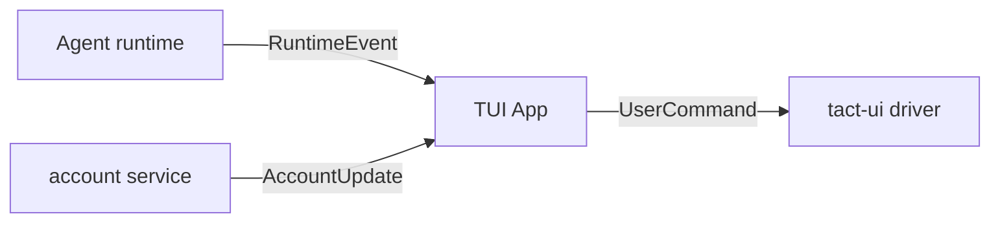
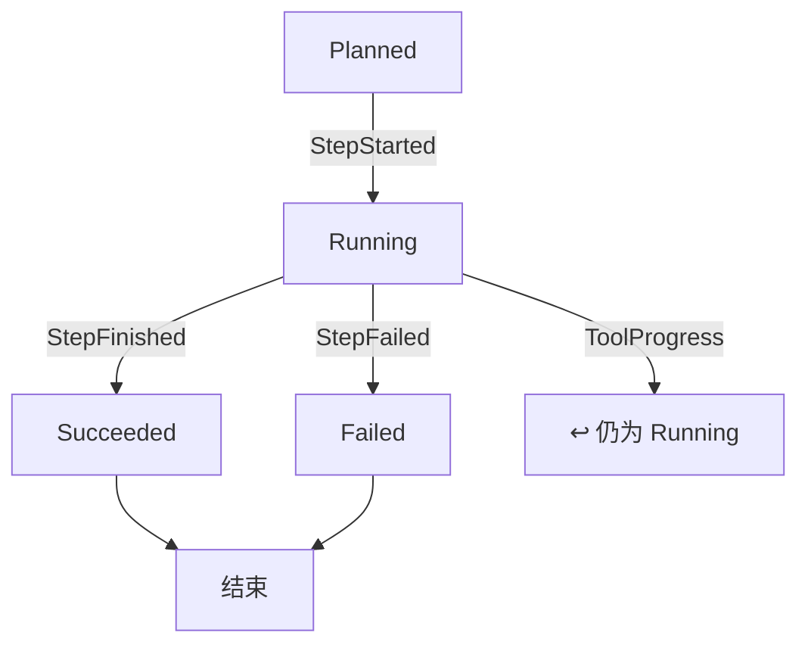
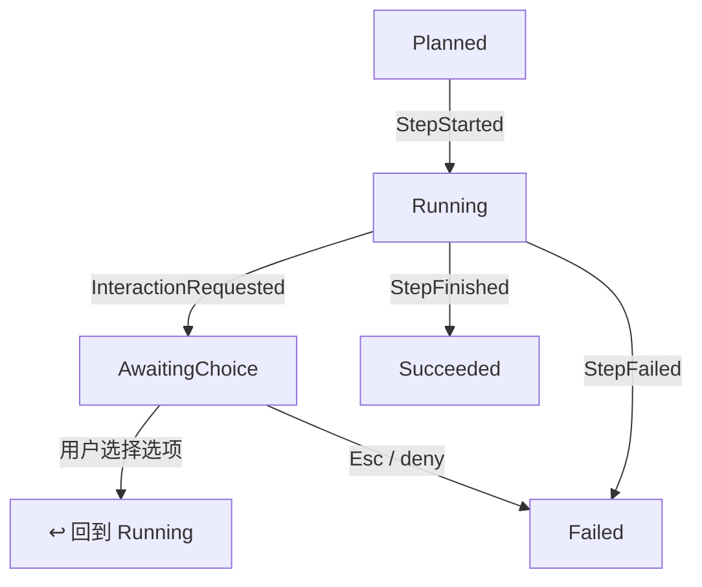
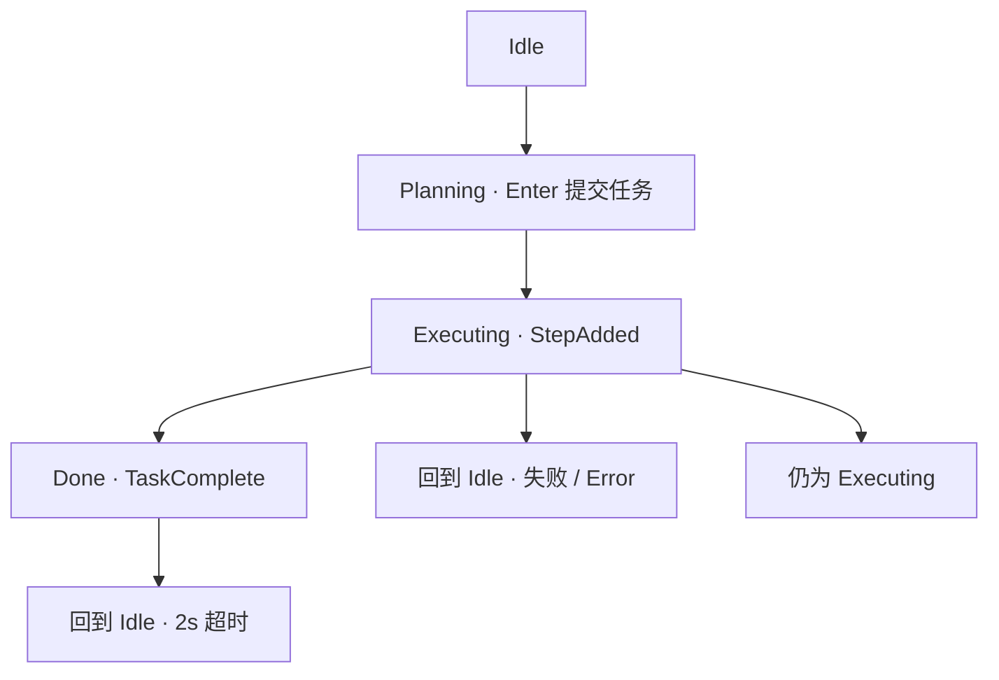
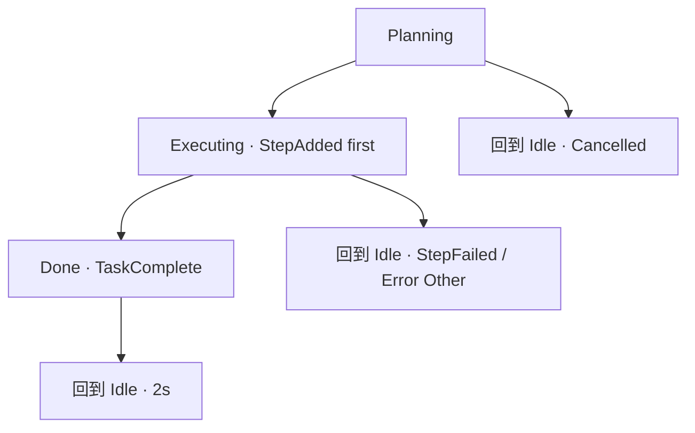
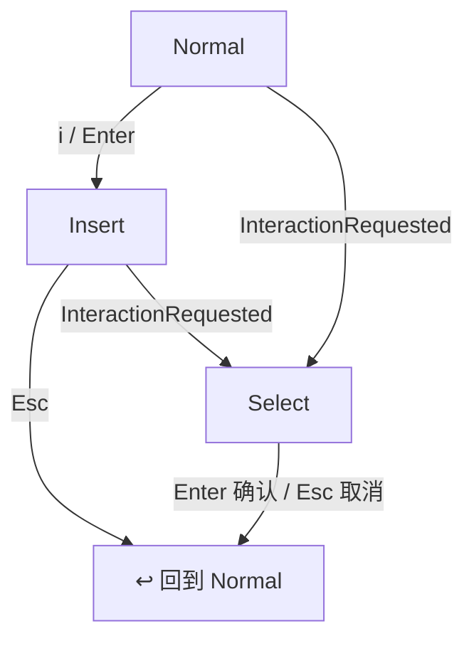
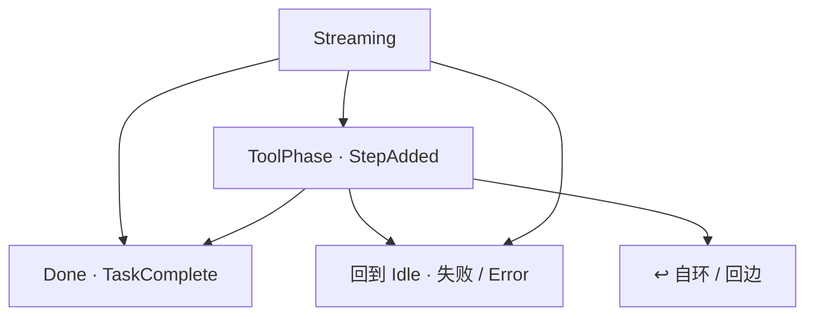
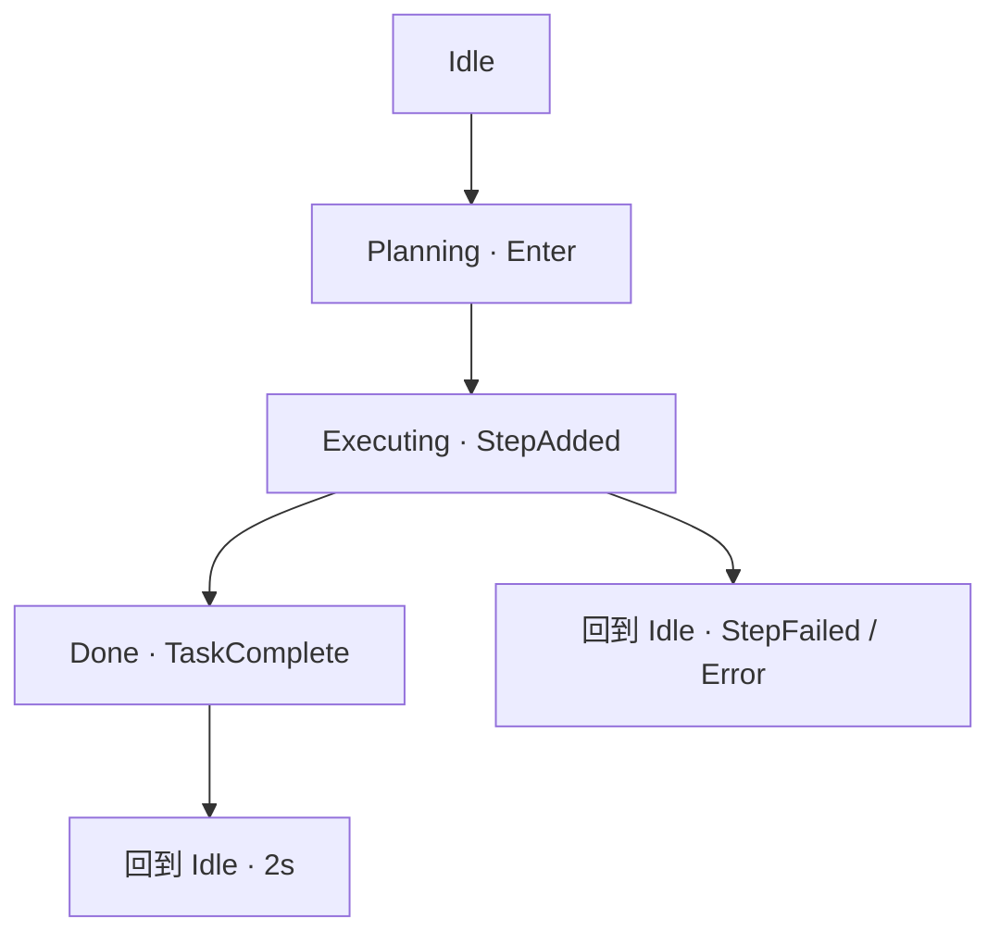
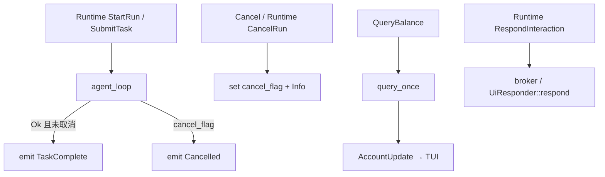
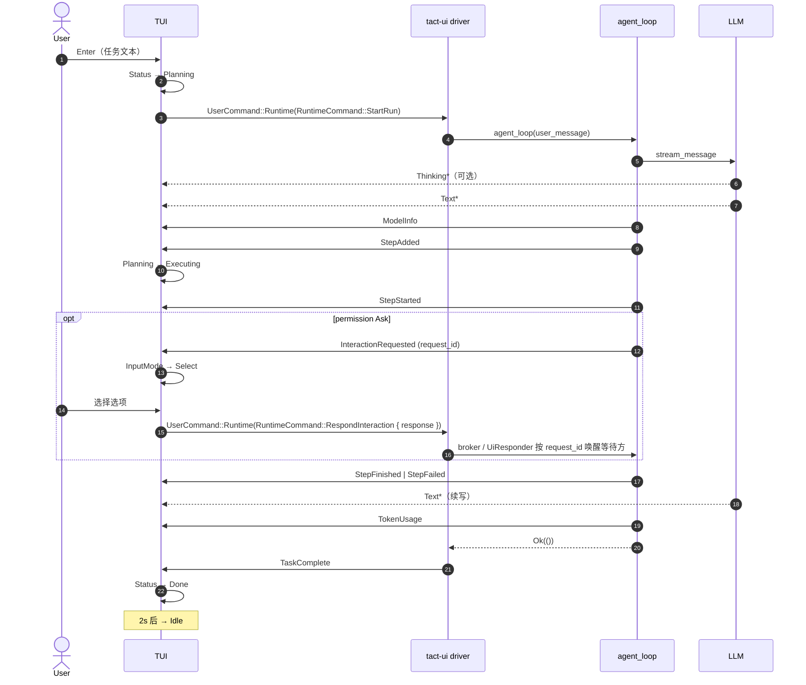

# Agent–TUI 协议（Agent–TUI Protocol）

本章文档化 `tact_protocol` crate：agent 运行时与终端 UI 之间交换的消息类型，以及各 `RuntimeEvent` variant 如何在两侧驱动状态转换。

实现：`crates/tact_protocol/src/agent.rs`、`crates/tact_protocol/src/biz.rs`、`crates/tact_protocol/src/runtime.rs`、`crates/tact_protocol/src/interaction.rs`。反向命令（`UserCommand`）在 View 契约 crate：`crates/tact_view/src/lib.rs`。TUI 消费者：`crates/tui/src/widgets/state/app/agent.rs`。Agent 发出者：`crates/tact_extensions/src/agent/tool_dispatch.rs`、`crates/tact_llm`（流式）。

相关章节：[Ch 18 Agent Loop](./18_chapter_agent_loop_zh.md)、[Ch 23 TUI](./23_chapter_tui_zh.md)。其他状态机（输入模式、权限、任务）见 [docs/state_machines.md](../docs/state_machines.md)。

---

## 1. Channels



| Channel | 类型 | 方向 | 用途 |
|---------|------|------|------|
| `agent_tx` / `agent_rx` | `RuntimeEvent` | Agent → TUI | 进度、流式、元数据、交互请求 |
| `user_cmd_tx` / `user_cmd_rx` | `UserCommand` | TUI → driver | 提交任务、取消、交互应答、余额 / 统计查询、MCP / hooks 操作 |
| `account_tx` / `account_rx` | `AccountUpdate` | Account → TUI | 余额 / 配额（与 agent 协议分离） |

所有通道均用 `tokio::sync::mpsc::unbounded_channel`。`RuntimeEvent` 是**纯数据**：`InteractionRequested` 内的 `InteractionRequest::Select` / `MultiSelect` 携带 `request_id` 而非内嵌的 `oneshot::Sender`，因此该 enum 不再携带传输句柄（后续可自由派生 `Serialize`/`Clone`）。

反向方向只有一条通道：`UserCommand`（[§2](#usercommand)）。回答交互请求是其中的 `UserCommand::Runtime(RuntimeCommand::RespondInteraction { response: InteractionResponse })`。driver 先问会话的 Kernel interaction broker；broker 没有该 `request_id` 时才交给运行时共享的 [`UiResponder`] 注册表（`crates/tact_extensions/src/ui_responder.rs`）路由给等待中的调用方（父 agent 或 subagent）。应答走哪条路由由"哪个 id 空间接受它"决定，而不是在 driver 里按提示来源猜测。

交互模式下，共享的 `UiResponder` 还会暴露一个有序 pending snapshot；TUI 从该 snapshot reconcile `InputMode::Select`，并把 `InteractionRequested` 当作 wake-up hint。没有 broker 的 headless/tests 仍以该事件为权威。

---

## 2. 核心类型

### `RuntimeEvent`

```rust
pub enum RuntimeEvent {
    StepAdded { run_id: Option<RunId>, step: PlanStep },
    StepStarted { run_id: Option<RunId>, idx, tool_id, tool_name, arg_summary, arg_full, presentation: ToolPresentationInfo },
    ToolProgress { run_id: Option<RunId>, tool_id, chunks: Vec<ToolOutputChunk> },
    /// 子 agent 会话的一条**结构化**记录，与上一条扁平 chunk 并行发出。
    /// 扁平文本喂父工具卡的 live 预览与复制兜底；这条喂 subagent 弹窗
    /// （用主日志的 cell 渲染）。扁平流无法反推结构，所以两条都要。
    ToolTranscript { run_id: Option<RunId>, tool_id: String, entry: SubagentTranscriptEntry },
    StepFinished { run_id: Option<RunId>, idx, tool_id, result: StepResult },
    StepFailed { run_id: Option<RunId>, idx, tool_id, arg_summary, error },
    TaskComplete { run_id: Option<RunId>, content: String },
    /// 任务中取消 — TUI 必须离开 Planning/Executing
    Cancelled { run_id: Option<RunId> },
    Error { run_id: Option<RunId>, message: String },
    TokenUsage { run_id: Option<RunId>, usage: TokenUsageInfo },
    ModelInfo { run_id: Option<RunId>, params: ModelCallParams },
    Info { run_id: Option<RunId>, content: String },
    InteractionRequested { request: InteractionRequest }, // 选择请求：Select / MultiSelect / Confirm / Input
    Text { run_id: Option<RunId>, role: String, content: String },
    Thinking { run_id: Option<RunId>, chunk: ThinkingChunk },
    /// 持久任务列表变更（`task_create` / `task_update`）
    TasksChanged {
        run_id: Option<RunId>,
        tasks: Vec<TaskSnapshot>, // 不含已删除
        reason: TasksChangeReason, // Created | Updated
    },
    /// 后台任务（`background_run`）完成时终结 keep-live 卡片
    BackgroundTaskFinished { run_id: Option<RunId>, tool_id, success, message, output },
}

pub enum ThinkingChunk {
    Started,
    Delta(String),
    Finished,
}
```

`ThinkingChunk` 是生命周期 enum：生产者发出 `Started`、零或多个 `Delta` 片段，然后 `Finished`。仅暴露 `reasoning_content` delta 的 OpenAI 兼容 adapter 在流周围合成 `Started` / `Finished`。

`TasksChanged` 在 mutating 任务工具成功后携带 UI 快照（`id`、`subject`、`status`、`owner`）。TUI 刷新 Log 下 sticky 条并追加 Log 详情卡片。只读的 `task_get` / `task_list` 不发射。软删除项不出现在 `tasks` 中。

`ToolOutputChunk` 携带增量解码文本与 `ToolOutputStream`（`Stdout`、
`Stderr` 或 `Other`）。一个 chunk batch 保留 aggregator 观察到的跨 stream 顺序。
`ToolProgress` 是信息性的：不表示成功或失败；TUI 忽略未知或迟到的 `tool_id`。

### `UserCommand`

定义在 View 契约 crate：`crates/tact_view/src/lib.rs`（`/// User commands sent from the TUI to the Agent.`）。它是 TUI 的视图模型类型，不是跨语言的 Plugin Protocol，所以不放在 `tact_protocol`。

```rust
pub enum UserCommand {
    SubmitTask(String),                        // 提交一个自然语言任务
    Cancel,                                    // 取消进行中的任务（协作式 cancel_flag）
    Compact,                                   // 压缩会话历史（/compact）
    QueryBalance,                              // 查询账户余额
    QueryStats,                                // 查询会话统计（/stats）
    QueryBackground(Option<String>),           // 后台任务状态；None 列出全部（/background [id]）
    SetPermissionMode(String),                 // 设置权限模式（/permission 弹窗）
    SetThinkingBudget(usize),                  // 设置本会话 thinking budget（/model 弹窗）
    SetReasoningEffort(Option<String>),        // 设置 / 清除 reasoning effort（/model 弹窗）
    SetModel(String),                          // 设置本 agent 会话的模型（/model 弹窗）
    SubagentFinishedNotification { child_id, summary, success }, // 后台 subagent 完成
    CancelSubagent { child_id },               // 取消运行中的后台 subagent
    McpAuth { server },                        // MCP 远程服务器交互式 OAuth（/mcp auth）
    McpList,                                   // 列出 MCP server 与实时状态（/mcp list）
    McpPrompts { server: Option<String> },     // 已连接 server 发布的 prompt（/mcp prompts）
    RunMcpPrompt { server, name, arguments },  // 取一个 MCP prompt 并作为任务运行
    HooksList,                                 // 列出 hook 与审查状态（/hooks list）
    HooksTrust { all, source },                // 批准待审查 hook（/hooks trust）
    HooksForget,                               // 撤销所有 hook 批准（/hooks forget --all）
    Runtime(RuntimeCommand),                   // 客户端中立命令（迁移中的 catch-all）
}
```

共 20 个 variant。几个约定：

- 设置类（`SetPermissionMode` / `SetThinkingBudget` / `SetReasoningEffort` / `SetModel`）只改内存中的会话；持久化到 config 是另一条可选流程。
- `QueryStats` / `QueryBackground` 由 driver 主循环从共享快照直接回答，**不**等 in-flight 任务，弹出 read-out popup 而不是往会话里塞消息。
- `RunMcpPrompt.arguments` 是 `BTreeMap<String, String>`（源里写全了类型，这里从简）。
- `SubagentFinishedNotification` 由 driver 内部投递，不是用户操作。
- 最后一个是迁移期的客户端中立出口：`RuntimeCommand`（`crates/tact_protocol/src/runtime.rs`）的 `StartRun { run_id, input }`、`CancelRun { run_id }`、`RespondInteraction { response }`、`Subscribe { from_sequence }`、`Resume { trajectory_id, from_sequence }`、`Invoke { capability, input }`、`Shutdown` 都从这里进。

### `InteractionResponse` 与应答路径

**View 侧不再有自己的一套选择应答 enum** —— 它的旧名字在 `crates/` 里已经搜不到任何定义或使用（移除过程记在 [Ch 26](./26_chapter_issue_zh.md)）。**View 发回的是协议自己的 `InteractionResponse`**（`crates/tact_protocol/src/interaction.rs`），与请求同一 crate：

```rust
pub enum InteractionResponse {
    Approved { request_id: RequestId },                  // 批准权限请求
    Rejected { request_id: RequestId },                  // 拒绝权限请求
    Selected { request_id, values: Vec<String> },        // Select / MultiSelect 的选项
    Text { request_id, value: String },                  // Input 的文本
    Cancelled { request_id: RequestId },                 // 弹窗关闭 / Esc
}
```

它经 `UserCommand::Runtime(RuntimeCommand::RespondInteraction { response })` 回到 driver，driver 再按下面的顺序路由：

1. 先问会话的 **Kernel interaction broker**（`respond` 返回 `false` 表示没有这个 id 在等）。
2. 没人接，就交给共享的 **`UiResponder`**（`UiResponder::respond(response) -> bool`，`crates/tact_extensions/src/ui_responder.rs`）；它的 pending 表用数字 id，应答里的 `RequestId` 字符串解析回数字后查表。

两条路由并存是迁移中的事实，不是二选一的抽象：broker 的 id 空间属于**调用方**（插件自己选的 `RequestId`），`UiResponder` 的 id 由它自己分配，所以由"哪个接受"决定去向。

**为什么必须带 `request_id`：** 运行时要用它把应答送到**那一个**等待方 —— 父 agent、某个 subagent、或某个插件 invocation。driver 在 `user_cmd_rx` 上收到应答时**不**等待 in-flight 任务：它没有任何共享的可变 UI 状态要读，直接转发即可，这也是权限弹窗能在任务中途立刻被应答的原因。

### `PlanStep`

```rust
pub struct PlanStep {
    pub description: String,
    pub tool: String,
    pub tool_id: String,
    pub args: serde_json::Map<String, serde_json::Value>,
    pub output: Option<String>,
}
```

`args` 保留模型 JSON 对象顺序与嵌套值。TUI 运行时不再从 `args` 重解析工具特定字段 — `StepStarted.arg_full` 携带 agent 计算的显示字符串。

### `AccountUpdate`（biz 模块）

余额与配额更新使用专用 channel 上的 `AccountUpdate`，避免 provider 特定账户状态泄漏进 `RuntimeEvent`。见 `crates/tact_protocol/src/biz.rs` 与 `crates/tact_ui/src/account.rs`。

---

## 3. Plan Step 生命周期

assistant turn 中每次工具调用遵循 `tool_dispatch.rs` 固定的三阶段发出序列：



权限模式为 `Ask` 时，**`StepStarted` 之后、工具运行之前**可能出现 `InteractionRequested` popup。`Status` 保持 `Executing`；仅 `InputMode` 切换到 `Select`（[§4.3](#43-inputmode-叠加-interactionrequested)）。



> `AwaitingChoice` **仅逻辑阶段**：TUI Status 仍为 `Executing`，`InputMode = Select`。

| 阶段 | `RuntimeEvent` | Agent 发出者 | TUI 效果 |
|------|---------------|--------------|----------|
| Planned | `StepAdded(PlanStep)` | pre-flight | 追加到 `plan.steps`；`ensure_executing_status` |
| Running | `StepStarted { … }` | pre-flight | 推送 `ActiveToolBlock`；更新 `current_step` |
| Progress | `ToolProgress { tool_id, chunks }` | in-flight tool | 仅更新匹配 active block；保留 thinking/loading gate 与 scroll 意图 |
| Succeeded | `StepFinished { result }` | post-flight | `finalize_tool_block`；设置 `plan.steps[idx].output` |
| Failed | `StepFailed { error }` | permission / hooks / execution | 失败 tool card 或系统消息；`Status → Idle` |

**Keep-live 卡片（`ToolPresentationInfo.keep_live`）：** `background_run` 这类即发即忘工具在其底层工作完成前就已返回。它们的 `StepFinished` 只记录 plan step，**不会**终结卡片 —— `ToolProgress` 继续把实时输出流入仍活动的卡片，稍后的 `BackgroundTaskFinished { tool_id, success, message, output }` 以真实结果（✓/✗、耗时、最终输出）关闭它。若活动卡片已不存在（如重启后），TUI 退回显示一条系统消息。

**`arg_summary` vs `arg_full`：** `arg_summary` 截断（≤120 字符）供 log 标题行。`arg_full` 为完整参数字符串（路径、命令或原始 JSON），popup 与 diff 视图不依赖 TUI 内工具名启发式。

同一 turn 中并行工具各自运行上述序列。`StepFinished` 在各工具完成时发出 — 非整波 join 之后 — UI 显示并发进度（[Ch 11](./11_chapter_task_zh.md)）。

### 每工具发出顺序

```text
StepAdded
  → StepStarted { arg_summary, arg_full }
  → InteractionRequested?   （仅 permission Ask）
  → ToolProgress*           （执行开始后；信息性）
  → StepFinished | StepFailed
```

独立工具可在波次层面交错，但每个 `tool_id` 保持此序列。
对于 `bash`，首个 progress batch 可立即发送；常规 batch 至少间隔 50 ms、最多
4 KiB，并在终态事件前 final flush。共享 output buffer 移除 ANSI CSI/OSC、应用
carriage-return 替换、保留 stream identity 供样式使用，并将 detail 限制为 50,000 字符。

---

## 4. 任务级流程

### 4.1 TUI `Status` 状态机

顶层执行状态在 `crates/tui/src/widgets/state/mod.rs`。驱动状态栏及是否可提交新 prompt。

```rust
pub(crate) enum Status {
    Idle,
    Planning,
    Executing { current_step: usize, total: usize },
    Done,
}
```



> - `Planning`：`UserCommand::Runtime(RuntimeCommand::StartRun)` 已发送。`Text` / `Thinking` 可能在首个 `StepAdded` 之前到达。
> - `Executing`：`UserCommand::Cancel` 设置 `cancel_flag` 并发出 `Info` —— Status 仍为 busy，直到 `Cancelled` 回到 `Idle`。

| 从 | 到 | 触发 | 说明 |
|----|-----|------|------|
| `Idle` | `Planning` | Insert 模式按 `Enter` | 清空 `app.plan.steps`；发送 `UserCommand::Runtime(RuntimeCommand::StartRun)` |
| `Planning` | `Executing` | 首个 `RuntimeEvent::StepAdded` | `ensure_executing_status`；`total` 来自 plan 长度 |
| `Executing` | `Executing` | `StepStarted { idx, … }` | 更新 `current_step`；可有并发 `ActiveToolBlock`s |
| `Executing` | `Done` | `TaskComplete` | 设置 `task_done_time`；冻结 cost timer |
| `Planning` / `Executing` | `Idle` | `Cancelled` | 取消后的 driver；释放输入 |
| `Executing` | `Idle` | `StepFailed` 或 `Error(Other)` | 冻结 cost timer |
| `Done` | `Idle` | `task_done_time` 后 2 s | 主循环调用 `maybe_expire_done_status` |
| *（不变）* | *（不变）* | `UserCommand::Cancel` | `Info("Cancelling…")` + 设 `cancel_flag`；随后 `Cancelled` |

`TaskComplete` 由 `crates/tact_ui/src/driver.rs` 在 `agent_loop` 返回 `Ok(())` 且 `cancel_flag` 为 false 时发送（[Ch 18 §7](./18_chapter_agent_loop_zh.md#7-tui-integration)）。取消路径改为发送 `Cancelled`。

### 4.2 `RuntimeEvent` → `Status` 映射

与 step 生命周期正交：哪些协议消息实际翻转 `Status`。



**不翻转 `Status` 的更新**：`Text`、`Thinking`、`TokenUsage`、`ModelInfo`、`Info`、`InteractionRequested`、`StepStarted`、`ToolProgress`、`StepFinished`，以及 `Executing` 之后的 `StepAdded`。

| `RuntimeEvent` | TUI `Status` / mode | 说明 |
|---------------|---------------------|------|
| `StepAdded`（首个） | `Planning → Executing` | `ensure_executing_status` |
| `StepStarted` | `Executing`（更新 `current_step`） | 可有多个并发 `ActiveToolBlock`s |
| `ToolProgress` | 无 status 变化 | 一个 active `tool_id` 的信息性 live output |
| `StepFailed` / `Error(Other)` | `→ Idle` | Cost timer 冻结 |
| `InteractionRequested` | `InputMode::Select`（Status 保持 `Executing`） | 见 [Ch 10](./10_chapter_permission_zh.md) |
| `TaskComplete` | `→ Done`（2s → `Idle`） | 由 driver 发出，非 `agent_loop` |
| `Cancelled` | `→ Idle` | 取消后的 driver；解除新 prompt 阻塞 |
| `TokenUsage` / `ModelInfo` | 无 status 变化 | 仅元数据；状态栏更新 |
| `Text` / `Thinking` / `Info` | 无 status 变化 | 仅 log / stream |

### 4.3 InputMode 叠加（`InteractionRequested`）

权限提示使用独立输入模式状态机。`InteractionRequested` **不**添加 `Status` variant — select popup 打开时状态栏仍可读 `Executing`。

在交互/broker 模式下，`Select` 由 `pending != empty` 推导；`InteractionRequested` 事件只负责唤醒 TUI，`UiResponder::snapshot()` 才是权威。下面的 event-driven 转换描述没有 broker 的 legacy/headless 路径。



> `Select` 到达时 `Status = Executing`。Broker 模式：由 pending snapshot 推导；Legacy/headless：`InteractionRequested` 事件驱动弹窗，应答经 `UiResponder::respond(InteractionResponse)`。

### 4.4 `Executing` 内逻辑阶段

`Status` 为 `Executing` 时，log panel 在流式与工具阶段间交替。这是**视图**状态，非独立 `Status` enum 值：



> 入口为 `Streaming`（首个 `Text` / `Thinking`）。`↩ 自环 / 回边` 是三条环的合并：`Streaming → Streaming`（更多 chunks）、`ToolPhase → ToolPhase`（`StepStarted` / `StepFinished` / `StepFailed`）、`ToolPhase → Streaming`（工具后 `Text`）。渲染器不支持环，故折成一个叶子节点。

---

## 5. 消息类别

| 类别 | Variants | TUI 副作用 |
|------|----------|------------|
| **内容产出** | `StepAdded`、`StepStarted`、`StepFinished`、`StepFailed`、`Text`、`Thinking`、`Info`、`TaskComplete`、`Cancelled`、`Error`、`InteractionRequested`、`TasksChanged` | 优先 `ThinkingChunk::Finished` 关闭 thinking；其他内容更新上 safety-flush；移除 loading placeholder；变更 log / plan |
| **仅元数据** | `TokenUsage(TokenUsageInfo)`、`ModelInfo(ModelCallParams)` | 仅更新状态栏；保留 loading placeholder；**不**关闭已开 thinking 区域 |
| **请求–响应** | `InteractionRequested { request: InteractionRequest::Select { … } }`、`InteractionRequested { request: InteractionRequest::MultiSelect { … } }` | Broker 模式：`snapshot()` 是权威，`InteractionRequested` 仅作 wake-up hint。Legacy/headless：经共享 `UiResponder`（反向的 `InteractionResponse`）阻塞等待用户选择。 |

Thinking 生命周期显式：`ThinkingChunk::Started` 打开区域，`Delta` 追加文本，`Finished` flush 并折叠。安全网：其他内容产出非 thinking 更新仍会在区域仍开时调用 `flush_and_close_thinking()`。`TokenUsage` / `ModelInfo` 从不关闭 thinking（可能 mid-stream 到达）。

---

## 6. `UserCommand` 转换

**TUI Status：**



**driver 与 account 通道：**



两处跨图连线：`Planning` 由 `Runtime(StartRun)` 触发（图 1 的 `Planning` ← 图 2 的 `StartRun`）；`Cancel` 设置的 `cancel_flag` 让 `Executing` 收到 `Cancelled` 而回到 `Idle`（图 2 的 `set cancel_flag` → 图 1 的 `Executing`）。

下表把 TUI 侧的手势 / slash command 映射到真实 variant。"TUI 前置条件"列已逐条对过 `crates/tui/src/handlers/*` 与 `crates/tact_ui/src/driver.rs` 的 `match`。

| 命令 | TUI 前置条件 | Handler 效果 |
|------|--------------|--------------|
| `Runtime(StartRun { run_id, input })` | Insert 模式 `Enter`（`dispatch_user_task`，busy 时先入队）；任务文本在 `input["message"]`，`run_id` 由 TUI 生成 | 取出文本 → `run_submit`：有 serving 时 `chat.submit` invoke，否则直接跑一个 turn |
| `SubmitTask(text)` | 直接调用方（测试 / 非 View 通道）；TUI 自己已不再发它 | `run_chat_turn` 同步跑一个 turn |
| `Cancel` | `/cancel`，或 Planning / Executing 时 Normal 模式 `c`（`app.cancel_task()`） | 设 `cancel_flag` + `Info("Cancelling...")`；`runs.cancel` invoke；循环退出后 driver 发 `Cancelled` → `Idle` |
| `Runtime(CancelRun { run_id })` | 运行时通道的等价取消（带具体 run id） | 同上；`runs.cancel` 指名该 run |
| `Compact` | `/compact`（仅 Idle / Done） | 等 in-flight 结束后 `chat.compact` invoke |
| `QueryBalance` | `/balance`（仅 DeepSeek / Kimi） | `account::query_once()` → `AccountUpdate` channel |
| `QueryStats` | `/stats` | 从共享 stats 快照直接回答 → `PopupMarkdown`，不等 in-flight |
| `QueryBackground(task_id)` | `/background`、`/background <id>` | 从共享 background manager 回答 → popup |
| `CancelSubagent { child_id }` | `/subagent_cancel <child-id>`，或 subagent 工具卡上的取消按钮 | 置子 agent 协作取消位，标 run 为 Cancelled → `SubagentsChanged` |
| `SetPermissionMode(mode)` | `/permission` 弹窗确认 | 设置本会话权限模式（不写 config） |
| `SetThinkingBudget(n)` | `/model` 弹窗确认 budget | 改本会话 thinking budget |
| `SetReasoningEffort(Some/None)` | `/model` 弹窗确认 effort | 设置 / 清除本会话 reasoning effort |
| `SetModel(model)` | `/model` 弹窗确认模型 | 改本 agent 会话的模型 |
| `McpAuth { server }` | `/mcp auth <server>`（`/mcp login` 同义） | 跑 OAuth 流程，成功后重载 MCP router |
| `McpList` | `/mcp list` | 从**已连接**的 router 列出 server 与实时状态 |
| `McpPrompts { server }` | `/mcp prompts`、`/mcp prompts <server>` | 从已连接 router 列出 prompt（只读） |
| `RunMcpPrompt { server, name, arguments }` | `/mcp prompt <server> <name> [key=value …]` | 取回并渲染 prompt → 当普通任务提交；空 `name` 由 driver 拒绝 |
| `HooksList` | `/hooks list`（或裸 `/hooks`） | 读 hook 源与审查记录，列出状态 |
| `HooksTrust { all, source }` | `/hooks trust --all` 或 `/hooks trust --source <label>` | 批准待审查 hook；裸 `trust` 只给用法提示 |
| `HooksForget` | `/hooks forget --all` | 撤销全部 hook 批准 |
| `SubagentFinishedNotification { … }` | 后台 subagent 完成（driver 内部投递，非用户操作） | 父 agent 空闲则合成唤醒 turn，忙则挂起到当前 turn 结束 |
| `Runtime(RespondInteraction { response })` | `Select` / `MultiSelect` 弹窗的 `Enter`/`Esc`，权限弹窗的批准 / 拒绝，或 Kernel `Input` prompt 提交文本 | broker 先收（id 匹配才收），否则 `UiResponder::respond` |

---

## 7. 典型消息顺序

单次 assistant turn、一次工具调用：



文本时间线（同一 turn）：

```text
Thinking*               ← LLM 推理流（可选）
Text*                   ← 工具前/之间的 assistant 文本
ModelInfo               ← 模型名 / max_tokens（元数据）
StepAdded               ← 内部 plan step 条目（无专用面板）
StepStarted             ← 运行中 tool card（arg_summary + arg_full）
InteractionRequested?   ← permission Ask（可选）
StepFinished | StepFailed
Text*                   ← assistant 续写文本
TokenUsage              ← 最终 usage chunk（元数据）
TaskComplete            ← agent_loop Ok 后 driver
```

流式 chunk 可在 step 事件之间到达。`TokenUsage` 通常在 `stream_options.include_usage` 设置时从最终 LLM 流 chunk 发出。

---

## 8. 类型参考

| 类型 | 文件 | 角色 |
|------|------|------|
| `RuntimeEvent` | `crates/tact_protocol/src/runtime.rs` | Agent → TUI 事件 enum |
| `RuntimeCommand` | `crates/tact_protocol/src/runtime.rs` | 客户端中立命令（`StartRun` / `CancelRun` / `RespondInteraction` / `Subscribe` / `Resume` / `Invoke` / `Shutdown`） |
| `InteractionRequest` | `crates/tact_protocol/src/interaction.rs` | 交互请求（`Permission` / `Select` / `MultiSelect` / `Confirm` / `Input`），全部携带 `request_id` |
| `InteractionResponse` | `crates/tact_protocol/src/interaction.rs` | 交互应答（`Approved` / `Rejected` / `Selected` / `Text` / `Cancelled`） |
| `ThinkingChunk` | `crates/tact_protocol/src/agent.rs` | Thinking 流生命周期（`Started` / `Delta` / `Finished`） |
| `UserCommand` | `crates/tact_view/src/lib.rs` | TUI → agent 命令 enum |
| `PlanStep` | `crates/tact_protocol/src/agent.rs` | 内部 plan step 条目（无专用面板）；serde 供 session 持久化 |
| `StepResult` / `StepStatus` | `crates/tact_protocol/src/agent.rs` | 结构化工具结果 |
| `TokenUsageInfo` | `crates/tact_protocol/src/agent.rs` | LLM token 计数（含 cache / reasoning） |
| `ModelCallParams` | `crates/tact_protocol/src/agent.rs` | 活跃模型配置快照 |
| `AgentErrorKind` | `crates/tact_view/src/lib.rs` | 致命错误分类（`Display` + `Error`） |
| `BalanceInfo` / `UsageQuotaInfo` | `crates/tact_protocol/src/biz.rs` | 账户查询结果（`f64` 金额、`Option<f64>` 配额） |
| `AccountUpdate` / `AccountError` | `crates/tact_protocol/src/biz.rs` | Account channel 消息 |

---

## 9. 相关资源

- 协议源码：[crates/tact_protocol/src/agent.rs](../crates/tact_protocol/src/agent.rs)
- 运行时消息（`RuntimeEvent` / `RuntimeCommand`）：[crates/tact_protocol/src/runtime.rs](../crates/tact_protocol/src/runtime.rs)
- 交互请求 / 应答：[crates/tact_protocol/src/interaction.rs](../crates/tact_protocol/src/interaction.rs)
- View 契约（`UserCommand` / `AgentErrorKind`）：[crates/tact_view/src/lib.rs](../crates/tact_view/src/lib.rs)
- Biz 类型：[crates/tact_protocol/src/biz.rs](../crates/tact_protocol/src/biz.rs)
- TUI handler：[crates/tui/src/widgets/state/app/agent.rs](../crates/tui/src/widgets/state/app/agent.rs)
- Tool dispatch 发出者：[crates/tact_extensions/src/agent/tool_dispatch.rs](../crates/tact_extensions/src/agent/tool_dispatch.rs)
- 其他状态机：[docs/state_machines.md](../docs/state_machines.md)
