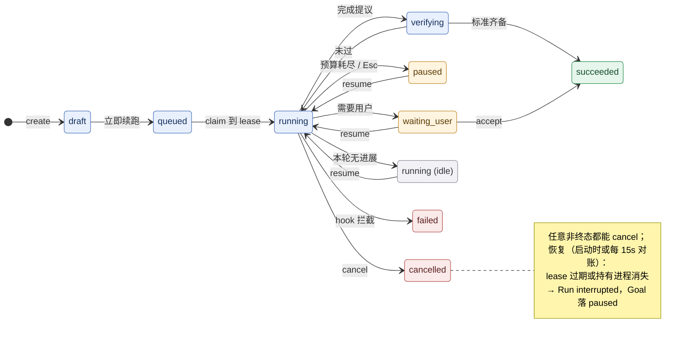
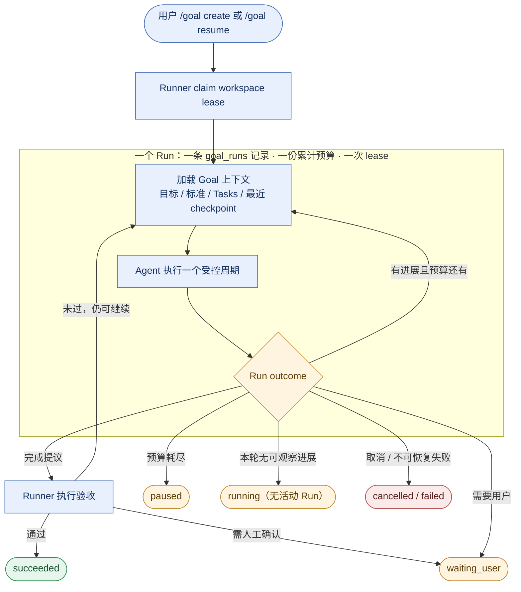

# Agent Goal：持久化目标执行

> **文档状态：已实现（2026-10-15）。** 本章描述当前源码提供的 Goal 生命周期、SQLite 持久化、bounded Runner、协议命令与 TUI 投影；仍未覆盖的高级能力在文末单独列出。

本章讨论 Tact 如何支持跨多个 turn、可暂停、可恢复、可监督并可验证完成的长期工作。设计建立在现有 [`TaskManager`](./19_chapter_persistent_tasks_zh.md)、[`agent_loop`](./18_chapter_agent_loop_zh.md)、SQLite session store、权限管理和 TUI 协议之上；它不是对某个 Agent CLI 的复刻，而是 Tact 自身的领域设计。

---

## 1. 核心定义与边界

Goal、Task、Turn 和 PlanStep 是不同层级，不能互相替代：

| 概念 | 职责 | 生命周期 |
|------|------|----------|
| **Goal** | 用户希望最终达成的结果，以及（可选的）证明结果达成的验收标准 | 可跨 session、跨多个 run 持续；直到成功、失败或取消 |
| **Task** | 为 Goal 服务的可执行工作项、状态和依赖关系 | 由现有持久任务系统管理，可关联 Goal，也可独立存在 |
| **Run** | Runner 一次取得执行权后，对 Goal 的一次有预算的推进过程 | 有明确开始、结束、用量和结束原因；可被恢复或重试 |
| **Turn** | Agent 与模型之间的一次交互迭代，可能包含工具调用 | 属于 Agent loop；不是 Goal 的完成单位 |
| **PlanStep** | 当前执行过程的 UI 计划/步骤展示 | 临时显示状态，不承担跨进程持久化职责 |

核心规则：**Goal 是持久意图；Task 是工作图；Runner 是跨 turn 调度器；Agent 是在既有权限边界内工作的执行者；验收结果决定 Goal 是否成功——没有验收标准时，成功就是经过标注的自证完成。**

普通的一次性问题仍然是普通对话，不应自动创建 Goal。用户显式创建或确认 Goal 后，Goal 才进入持久化执行生命周期。

---

## 2. 用户可见行为

1. 用户通过 `UserCommand::CreateGoal` 或 `/goal create <objective> [-- <标准>; <标准> ...]` 创建 Goal。验收标准**可选**：不写 `--` 段时，Goal 以「模型提交完成提议即完成」的方式运行，事件里如实标注 self-attested 并附上模型自述的检查（见 §6）；写了 `--` 段，每条标准都会成为必需的 Human 标准，完成前需要 `/goal accept`。
2. 创建成功后 driver **立即**把 Goal 交给 Runner 启动第一次 activation（`Draft → Queued → Running`），不需要额外的启动命令：Runner 创建一次有预算的 Run，并让 Agent 检查现状、规划和维护关联 Task DAG。该 activation 在命令循环之外的可取消任务里运行，因此运行期间 `Cancel`、`/goal list`、`/goal pause`、`/goal steer` 与 `/goal cancel` 仍然可响应：暂停/取消先写入请求事件并触发 `cancel_flag`，Runner 在下一个安全点停下；steer 在下一次 activation 注入。
3. 如果仍有可执行工作、没有用户阻塞且预算充足，Runner 可以启动下一执行周期；单次 `agent_loop` 正常结束只表示本次交互结束，不代表 Goal 完成。
4. 需要用户决定时，Goal 等待用户；需要权限时，继续使用现有权限流程，不推导或扩大授权。
5. Agent 认为目标已满足时，提交**完成提议**及不可信的 criterion claims，由 Runner 验证。claims 不会写入 evidence；模型的完成文字、所有 Task 已完成或某个 turn 正常结束，均不是成功判据。
6. 声明了必需标准的 Goal，只有该标准的当前版本 evidence 齐备才能成功：人工标准由 `/goal accept` 写入 evidence。未声明必需标准的 Goal 在模型提交完成提议时直接成功，完成记录标注为 self-attested。自动验证尚未实现，Automatic 标准在创建/更新时被拒绝；验收失败则回到执行，预算耗尽或无法继续则暂停并说明原因。
7. 用户可查看、补充方向、暂停、恢复、取消或确认结果。对已结束 Goal 的重新执行必须是明确的用户操作，并留下事件记录。

当前命令表面：

```text
/goal list [--all]    列出当前工作区的 Goal（默认不含已归档）；为空时在 Log 里提示（此时面板不可见）
/goal create <text> [-- <标准>; <标准> ...]
                      创建 Goal（`--` 之前是标题与 objective，之后按 `;` 切成人工验收标准）并立即启动第一次 Run；不写标准则完成后以 self-attested 收尾
/goal show <id>       查看目标、标准、任务和验收摘要
/goal steer [<id>] <text> 立即补充方向或约束并写入事件（省略 id 时作用于当前运行中的 Goal；无运行中 Goal 时取唯一的非终态 Goal，多个候选则要求显式 id）；下一次 activation 的 context 会看到它，不阻塞当前 Run
/goal pause <id>      暂停执行；Run 活跃时写 pause_requested 并中断当前模型/工具波次，Runner 落到 paused
/goal resume <id>     恢复执行
/goal cancel <id>     取消 Goal；Run 活跃时写 cancel_requested 并触发 cancel_flag，终态为 cancelled
/goal accept <id>     接受人工验收项 / 完成提议
/goal archive <id>    把已结束的 Goal 归档（移出面板与默认列表，记录不删）
/goal unarchive <id>  取消归档，重新出现在面板里
```

**暂停 vs 取消（2026-10-17）：** 运行中按 Esc / TUI 的 Cancel 按钮只中断当前 Run，Goal 回到 `paused`，之后可以 `/goal resume`；只有 `/goal cancel <id>` 会写入终态 `cancelled`。这样一次误触不会毁掉长任务，取消仍是显式的用户决定。

**回复即回答（2026-10-18）：** 当 Goal 通过 `goal_request_input` 提了问题、状态停在 `waiting_user` 时，用户下一条普通消息**就是回答**：driver 把它记成 `user_answer` 事件并自动续跑该 Goal，不需要再敲 `/goal resume`（日志会说明这条消息去了 Goal）。判定要求唯一：只有「`needs_user` 事件晚于最后一次 `Running` 转移」且工作区里只有一个这样的 Goal 才走这条路——停在 `waiting_user` 等人工验收的 Goal 不算（那要 `/goal accept`），带 `@文件` / 图片引用的消息也走普通回合，避免丢附件。

**归档（2026-10-16）：** 已结束的 Goal 会一直躺在 sticky 面板与 `/goal list` 里，列表迟早被历史占满。`archive` 把它们移出**默认**列表：面板与 `/goal list` 只画未归档的 Goal，记录、Run、事件、标准全部保留。它是 `Goal` 聚合上的一个时间戳（`archived_at`）而不是新的 `GoalStatus` —— **状态是结局，不能被改写**（一个 `failed` 的 Goal 归档后仍报 `failed`），而新增状态会牵动状态机、转换表与既有行。只有终态 Goal 能归档（`Running` 之类会被拒绝并说明原因：把还在跑的活从面板上藏起来、活却继续跑），重复归档只是状态回报而不是错误；`unarchive` 走同一条 `GoalUpdate` 路径把戳清掉。归档也是**唯一**被允许写终态 Goal 的操作：`Goal::update` 对终态 Goal 只接受 `is_archive_only()` 的更新，标题/目标/标准/证据/状态照旧冻结。可达性：`/goal show <id>` 仍能打开归档的 Goal（正文里标 `**Archived:** yes`），`/goal list --all` 把它们放回面板并标 ` · archived`。

收 `<id>` 的八个动词在 TUI 里可以直接从补全菜单里挑 ID：打完 `/goal show ` 这样的前缀空格后，弹窗列出当前工作区里**该动词能作用**的 Goal，路径列是 ID、右列是面板同一行的状态标记与标题（可按 ID 或标题模糊匹配）。面板行不显示 ID、公告行会翻上去，补全菜单是不必回滚去找 ID 的地方。

这些命令映射为带 Goal ID 和用户文本的 typed `UserCommand`；list/show/steer/pause/cancel 在 Agent activation 进行时也直接从 `SharedGoalManager` 读取，不等待 Run 的 `JoinHandle`。

### 操作流程（命令 → 状态 → 恢复）



`create` = `/goal create`，`resume` = `/goal resume`，`accept` = `/goal accept`，`cancel` = `/goal cancel`。

> **写法说明**：这张图是给标准 Mermaid 渲染器（GitHub / VS Code / Obsidian）看的——`stateDiagram-v2` 的状态机、`classDef` 配色与 `note` 注记都属于这一层。Tact 自带的 TUI 渲染器**有意不画带标签的 stateDiagram**：上游解析会把转移标签 `: …` 并进节点名（`Idle --> Planning: startup` 会画出名为 `Planning: startup` 的节点），画出来的不是这个状态机，所以渲染路径直接回退成源代码块（2026-10-17）。终端里读请看下面编号的 5 条流程。

1. **创建即首跑**：`/goal create` 落库为 `draft`，driver 紧接着调用与 `/goal resume` 相同的入口，把 Goal 推进到 `queued → running` 并启动第一次 activation。首跑在任何显式 resume 之前发生，但状态转换本身是带 lease 的持久化写入。
2. **运行中的控制不排队等 Run 结束**：`/goal pause`、`/goal cancel`、`/goal steer` 与 Esc 都直接作用于 `SharedGoalManager` / `cancel_flag`——前两者先写 `pause_requested` / `cancel_requested` 事件再中断当前 activation，steer 只追加事件、在下一个 activation 的 context 里可见。
3. **一次 Run 结束后状态由 stop 映射决定**，不由模型自述决定：需要用户 → `waiting_user`；预算耗尽或 Esc → `paused`；无进展 → 保持 `running`（无活动 Run，等下一次显式 resume）；验收通过 → `verifying → succeeded`；hook 拦截 → `failed`；显式取消 → `cancelled`。
4. **收尾只有一条路**：结果写进 `goal_runs`、状态迁移写进 `goals`、事件追加进 `goal_events`，三者是一个事务（`finish_run_and_transition`）；lease 在 `activate` 的单一释放点归还，崩溃则留给恢复。
5. **恢复有两条触发时机、同一判据**：启动时跑全量对账（中断死 lease 的 Run，并把所有「`running` 但没有活动 Run」的 Goal 落到 `paused`）；命令循环每 15 秒派生一次收窄版对账（只落它刚刚中断的那几个 Goal）。判据都是「lease 过期 **或** 持有进程消失」，见 §7。定时对账刻意不落 idle `running`：那是本轮 `no_progress` 的合法落点，不能由后台把用户的任务按暂停；它也在独立任务里跑，数据库写锁被别的进程占住时命令循环仍能响应 Esc 与 `/goal pause`。

---

## 3. 生命周期与执行阶段

当前 Goal 状态：

```text
draft → queued → running → verifying → succeeded
                    │          │
                    ├─ waiting_user
                    ├─ waiting_permission
                    ├─ paused
                    ├─ failed
                    └─ cancelled
```

| 状态 | 含义 |
|------|------|
| `draft` | 目标和验收标准仍在确认，尚未授权 Runner 开始推进 |
| `queued` | 用户已确认，等待 Runner 获得执行 lease |
| `running` | Runner 持有 lease，Agent 正在推进工作 |
| `waiting_user` | 需要用户补充信息、决定方向或完成人工验收；提问类等待可直接用下一条消息回答并续跑（见 §2） |
| `waiting_permission` | 保留状态，当前没有生产者（见 §12）：非交互模式下权限门自行裁决，交互式弹窗在 activation 内被回答 |
| `paused` | 用户暂停/中断、预算耗尽，或恢复逻辑把 stranded `running`（lease 过期，或持有该 lease 的进程已消失）落到 paused |
| `verifying` | Agent 已提交完成提议，必需验收项正在核验 |
| `succeeded` | 所有必需验收条件均有有效证据并通过；没有必需标准时表示 self-attested 完成（事件里写明） |
| `failed` | 已确认无法继续且 Goal 以失败结束；暂时性错误不应直接记为失败 |
| `cancelled` | 用户明确取消，或确认终止 Goal |

`phase` 是独立字段，用于显示当前 `planning`、`execution` 或 `verification` 阶段；不要将 phase 与生命周期状态塞进同一个枚举。

每次 Run 结束都带明确 outcome，而不是让 driver 从 `Result<()>` 或最后一段模型文字猜测：

```text
progress_made | needs_user | needs_permission | completion_proposed
budget_exhausted | paused | no_progress | cancelled | transient_error | fatal_error
```

Runner 根据 outcome、任务图、验收状态和预算决定状态转移。暂停、等待和 run 结束都要先落库，再通知 UI。

当前真正会被写出的 outcome：`progress_made`（有可观察进展，继续下一周期）、`no_progress`（只说了话、没做可观察的事，本次 Run 结束、Goal 保持 `running`）、`budget_exhausted`、`paused`（用户暂停或 Esc 中断）、`completion_proposed`、`needs_user`、`cancelled`（显式 `/goal cancel`）、`transient_error`、`fatal_error`。`needs_permission` 与状态 `waiting_permission` 一样属于保留项（见 §12）。

---

## 4. 持久化模型

Goal 数据与会话 transcript 分开：transcript 记录对话事实；Goal 表记录当前可查询的结构化状态；事件表保留审计轨迹。领域记录沿用同一个工作区的 `.tact/tact.db`。

实际存储采用「**整行 JSON + 少量索引列**」：领域结构体（含标准、证据、预算用量、checkpoint）序列化进 `data` 列，查询和排序只依赖几列不变量。进化领域字段不需要迁移；契约稳定的是聚合语义与索引列。

标识符由 `goal::new_id()` 统一铸造：Goal、标准、Run、Event 共用 **8 位十六进制**短 ID（`git log` 风格）。这些 ID 同时出现在用户要读要敲的地方（`/goal show`、创建提示、`/goal <id>` 命令）和模型要回填的地方（`goal_propose_completion` 的 `criterion_id`、每次 activation 注入的 `<goal-context>`），完整 UUID v4 的 36 字符在这两处都是纯浪费。Goal 按工作区划分且数量很少，32 位空间足够；ID 在所有代码路径上都是不透明字符串，从不解析、不校验长度，因此历史库里更长的 UUID 行继续可用。

事件读取全部**有界**（2026-10-16）：每周期的进度判定用 `count_events` 计数比较，不 materialize 事件；注入上下文只取最近若干条（`list_recent_events`）；checkpoint、暂停原因、完成提议各是一条定向查询（`latest_event_of_kind` / `latest_event_with_status` / `has_event_of_kind_since`，均带 `ORDER BY seq DESC LIMIT 1`， newest-first 命中即止）。一次 activation 不再重读并 JSON-parse Goal 的全部历史——多周期循环下那曾是每周期两次全量读取。事件表本身仍不裁剪，`list_events` 保留给审计与展示。

### `goals`

```text
id TEXT PRIMARY KEY, data TEXT NOT NULL,
status TEXT NOT NULL, version INTEGER NOT NULL, updated_at INTEGER NOT NULL
```

索引：`idx_goals_status`、`idx_goals_updated_at`。

`data` 是 `Goal` 聚合的序列化：标题、objective、约束、phase、session 关联、完成时间与摘要，以及**验收标准列表**——每条标准含描述、`required`、`verification_kind`、`status` 和带 `criteria_version` 标签的证据。标准随聚合整体提交，`version` 即标准/证据版本号：用户修改目标或标准时递增，旧版本证据自动失效。CRUD 路径经 `GoalManager`，不允许绕过它直写。

Goal 属于工作区，不只属于创建它的 session。创建 session 与当前执行 session 分开记录，允许用户在后续 session 中查看和恢复。

### `goal_criteria`（不存在独立的表）

标准不是独立表：它嵌在 `goals.data` 的聚合里，随版本号一起写入。这样证据失效只需比较 `criteria_version`，不存在「标准改了、证据还在旧表里」的分叉。

交互式 `/goal create <objective> -- <标准>; <标准>`（2026-10-18）就是往这个聚合里写 `Human` 标准：`--` 之后按 `;` 切分，每条非空片段成为一条必需的 Human 标准，成功前必须有它们的当前版本 evidence。不写 `--` 段则标准列表为空，表示「模型提交完成提议即完成，完成记录标注 self-attested」；API 调用方仍可直接构造 `CreateGoal.criteria`。

### `goal_runs`

```text
id TEXT PRIMARY KEY, goal_id TEXT NOT NULL, data TEXT NOT NULL,
state TEXT NOT NULL CHECK (state IN ('running', 'completed', 'interrupted')),
started_at INTEGER NOT NULL, finished_at INTEGER, stop_reason TEXT
```

索引：`idx_goal_runs_state`、`idx_goal_runs_goal_id`、`idx_goal_runs_started_at`。

`data` 是 `GoalRun` 记录：outcome、`turns_used` / `tool_calls_used` / `elapsed_ms` / `tokens_used`、checkpoint 和结束原因。Run 记录一次 lease 周期和资源消耗。进程异常退出时可以将过期的活动 Run 标为 `interrupted`，并在创建新 Run 时保留关联关系，不覆盖旧记录。

### `goal_events`

```text
seq INTEGER PRIMARY KEY AUTOINCREMENT,
id TEXT NOT NULL UNIQUE, goal_id TEXT NOT NULL,
data TEXT NOT NULL, occurred_at INTEGER NOT NULL
```

索引：`idx_goal_events_goal_seq`（`goal_id, seq`）——按 Goal 取区间事件。

追加式事件日志：创建、用户修改目标或标准、状态转移、Task 关联、Run 开始/结束、验收结果、steering、恢复、取消等。`seq` 保证全局顺序。事件用于诊断和审计；不能只依赖内存队列或 TUI 收到过的事件来恢复状态。

### `goal_leases`

```text
singleton INTEGER PRIMARY KEY CHECK (singleton = 1),
owner TEXT NOT NULL, epoch INTEGER NOT NULL, expires_at INTEGER NOT NULL
```

工作区内**单行** lease：`singleton = 1` 由 CHECK 约束保证只能有一个写入者。`epoch` 是递增的 fencing 代，所有状态写入必须携带当前 epoch。

### Task 关联

现有 `tasks` 表增加可空 `goal_id`，并建 `idx_tasks_goal_id_id` 索引。既有 Task 不需迁移出虚构 Goal；没有 `goal_id` 的任务继续照常工作。任务依赖仍由现有 DAG 管理。

Goal 生命周期更新、Run outcome 写入和事件追加应在可行时使用同一 SQLite 事务，避免 UI 看见已暂停但 run 仍显示活跃等不一致状态。迁移必须幂等，兼容已有数据库。

---

## 5. Runner 与 Agent 主循环

`GoalRunner` 属于 session/command driver 的编排层，不属于 `Agent::agent_loop` 内的无限循环：



> **写法说明**：同上，`subgraph` 与 `classDef` 属于标准 Mermaid 渲染器；TUI 只吃扁平的 `graph`/`flowchart` + `-->`，终端里这张图会回退成源码块——循环语义见紧随其后的段落。

Agent loop 仍负责单次模型交互、工具 dispatch、hooks、权限、会话消息与 compaction。Goal 模式额外返回显式的 yield outcome；普通对话维持原有任务语义。

**一次 Run 是"一个 lease 周期 + 一到多个受限 activation"**：`GoalRunner::run_with_lease` 在同一个 Run 内循环执行 activation，只有上一个 activation 留下可观察进展（执行过工具调用或追加过 Goal 事件）且 Run 的累计预算仍有剩余时才进入下一个周期；否则以 `progress_made` / `no_progress` 结束该 Run。所有周期共享同一条 Run 记录、同一次 lease 和同一次收尾事务——不会每个周期各写一条 Run。

每个新周期开始时，Runner 都重新注入精简且权威的 Goal 上下文：目标、硬约束、验收标准摘要、关联 Task 状态、最近 checkpoint 和暂停原因（Goal 工具在周期内追加的 checkpoint/事件，下一个周期就能看到）。完整事件历史按需查询，不应每轮无界地注入 prompt。上下文应以明确标签与边界传递，不能让来自历史/tool output 的内容覆盖用户约束。

Agent 可报告 checkpoint、提出 Task 变更、请求用户输入、请求权限或提交完成提议；Goal 状态的最终写入权归 Runner/GoalManager。Subagent 不继承父 Goal 绑定，也没有 Goal 工具；它只通过委派 prompt 获得必要的上下文，不能结束或重开父 Goal。

---

## 6. 验收：有标准才门禁，没标准就自证

- **验收标准是可选的。** 交互式 `/goal create` 默认不声明标准，于是 Goal 走「模型提交完成提议 → `verifying → succeeded`」这一条路，`waiting_user` 不再出现在默认路径上（2026-10-18）。
- **有必需标准才门禁。** `GoalManager::create` 与 criteria 更新允许空/全 optional 列表，但只要有 required 标准，成功就必须等齐它们的当前版本 evidence；`Goal::validate_acceptance` 只检查 required 的那些。
- **「自证完成」必须留痕。** 没有必需标准的 Goal 成功时，`status_changed` 事件写 `completion self-attested: the Goal has no required acceptance criteria`，`run_finished` 事件写 `note=verification: none (self-attested)`，日志行也带 `(self-attested: no acceptance criteria)`。这不是「验证通过」，历史里不能读成验证过。
- **模型自述的检查一并入库**（2026-10-18）：`goal_propose_completion` 接受可选的 `checks`（例如「cargo test --workspace: 1405 passed」），事件里存为 `self_reported_checks`，并在 self-attested 的完成记录后追加 `; model-reported checks: …`（每条截断、最多 4 条）。它是模型自己的说法，**不是**验收证据，也不会让 Goal 变成 verified——但比只留一句「done」可审计得多。
- 自动验证尚未实现：`GoalCriterion::required` 默认是 Human，`GoalManager::create` 和 criteria 更新拒绝 Automatic；遗留的 Automatic 标准可由用户 `/goal accept` 显式关闭。Goal 不提供绕过 permission manager 的“可信命令”通道。
- 人工验收由用户显式确认，并记录确认者、时间及针对的标准版本；`/goal accept` 仍是唯一写入 evidence 的生产路径。
- Agent 提交完成提议后，Runner 先验证：`Verified`（含没有必需标准的空验证）才进入 `verifying` 并立即成功；`NeedsUser` 转 `waiting_user`；未满足的自动标准保持 `running` 或按预算暂停。
- 必需人工标准未满足时转为 `waiting_user`；用户 `/goal accept` 写入 evidence 后成功。标准被标记 Rejected 时只能通过重定义 criteria 恢复（当前没有 TUI 编辑命令）。
- 验收失败时回到 `running` 修复；预算耗尽则转 `paused` 并列出失败项。不得把“任务清单清空”当作验收通过。
- 用户修改目标或验收条件时提升版本号；旧版本的证据不能默认为新版本通过，必须按影响重新验证。

> **为什么取消默认标准**（2026-10-18）：driver 曾给每个 `/goal create` 补一条必需的 Human 标准「User accepts the completed result」。生产代码里唯一能写 evidence 的路径是 `/goal accept`，于是**每个** Goal 都必然停在 `waiting_user`，用户按一下接受只是把「模型说做完了」盖章成「用户验收过」——既拦不住错误，又多了一次必然等待。现在默认没有门禁，要门禁就显式声明标准。

---

## 7. 预算、并发与恢复

### 预算与进展保护

**一次 Run 由一到多个受限 activation 组成。** 整个 Run 的 turn 上限默认是 500（`GoalLimits::max_turns`，可用 `[goal].max_turns` 覆盖；每个 cycle 只拿到剩余额度），由 `agent_loop` 自己的 turn cap 在运行中强制；一个 activation 结束后，只有它在**可观察进展**（执行过工具调用，或追加过 Goal 事件——checkpoint、Task 关联、证据）且 Run 的累计预算仍有剩余时，Runner 才接着跑下一个 activation。纯文本回合（模型只说话、没有落地动作）结束本次 Run。

Run 的累计预算同样是 `GoalLimits` 的 500 turns / 600 秒墙钟时间（`[goal].max_turns` / `max_elapsed_secs`），跨 activation 累加到同一条 Run 记录上；达到上限时保存 checkpoint、用量和 stop reason，Goal 进入 `paused`。每个 cycle 传给 agent loop 的是**剩余** turn 数（`max_turns - turns_used`），且上限在 `turns_taken` 自增之前检查，所以停止时那次“探测”不会被记成一次模型调用——多 cycle 的 Run 不会花到约 2× 预算。工具调用数只作为用量记录（`GoalRun::tool_calls_used`），不设单独上限：每次工具调用本来就发生在一次模型调用之内，turn 上限已经约束了总扇出，单独计数只会让有用的 Run 提前结束。因为累计预算是按 turn 计的，周期数天然有界（每个周期至少消耗一次模型调用）。注意 `Agent::max_turns` 约束的是**进程累计**的 `turns_taken`，所以 Runner 传给循环的是「当前累计值 + 剩余预算」，而不是裸的预算数字。

**最后一轮会提醒模型写 checkpoint**（2026-10-17）：turn cap 在模型调用**之前**检查，所以最后一轮是模型唯一还能落盘的机会。该轮请求的 system prompt 末尾会追加 `<goal-budget-reminder>`，要求模型调用 `goal_checkpoint` 记录「已完成 / 仍待办 / 下一步」，避免 Run 在思考中途被截断、下一次 activation 从零重新发现。提醒只存在于该次请求的 system prompt 中，不进入会话历史；预算仍是硬约束，提醒只是软引导。

**Lease 在 Run 执行期间持续心跳**（2026-10-17）：`max_elapsed` 只在 activation 之间检查，单个 activation 可能远长于 lease TTL。Runner 在 cycles 运行期间按 `TTL/3` 刷新 lease，退出时 abort 并 await 心跳任务；收尾与释放只校验 owner+epoch（fencing），不再要求 lease 仍未过期——否则一个只是因为跑得久而过期、但未被接管的 lease 会丢掉整个 Run 的结果。

**activation 自己的判定优先于预算**（2026-10-16）：取消（`cancelled`）、被 hook 拦截（`fatal_error`/`failed`）、需要用户（`needs_user`）、验收通过（`succeeded`）这类终局判定即使与预算耗尽同时发生，也按判定记录。运行期间按 Esc / `c` 产生的是**暂停**（`paused`），不是终态取消；只有带 `cancel_requested` 事件的 `/goal cancel` 会把 Run 标成 `cancelled`（2026-10-17）。预算只在「本来还会继续」（`progress_made`，或验收被拒）时把 Run 标成 `budget_exhausted`/`paused`。

活动 Run 的 `turns_used` / `tool_calls_used` / `elapsed_ms` 在每个 activation 结束后写回 `goal_runs` 并刷新面板；单个 activation 运行期间面板显示上一次落库值，不会逐 turn 实时更新（2026-10-17）。

无进展检测只依赖可观察变化（工具调用、Goal 事件），不依赖模型自述：只有文字的周期记为 `no_progress` 并结束本次 Run，Goal 保持 `running` 等待下一次 activation——它不会因此被暂停，也不会被误记成 `progress_made`。单次失败或偶发网络错误同样不判定 Goal 失败：activation 报错记为 `transient_error` 并结束 Run，Goal 状态不变。人工验收不要求 Goal 恰好停在 `waiting_user`：`waiting_user`、`paused`（用户暂停或恢复把 stranded `running` 落到 paused）、以及没有活动 Run 的 `running` 都可以被 `/goal accept` 推进；只有活动 Run 在途时拒绝。这样用户消息把 Goal 唤醒后，刚提示的验收不会立刻失效，验收仍由 `GoalVerifier` 决定。

### Lease 与写入隔离

同一执行目录默认只允许一个写入型 Goal Runner。lease 包含**实例唯一** owner（session label + pid + 随机后缀）、过期时间/心跳、**持有进程身份**（`holder_pid` + `holder_identity`）和递增 fencing epoch。一个仍有效的 lease 永远不会被再次发放，即使 owner 字符串相同；只有持有 token 的实例可以 heartbeat/finish/release（2026-10-17）。**「有效」的定义包含持有者存活**（2026-10-17）：TTL 未到但 `holder_is_alive` 为假（进程已退出，或 pid 被复用而 start-time 身份不匹配）的 lease 立刻可被接管，不必等满 `max_elapsed + 60s`；identity 读不到、或来自其他平台的 identity 视为不可核验，退回纯时间过期语义，绝不抢一个可能仍活着的持有者。**「存在」与「可核验」必须分开判**（2026-10-17）：探测别的 uid 的活进程只会得到 `EPERM`（`kill -0`、macOS 的 `proc_pidinfo`、Linux 的 `/proc/<pid>/stat` 都一样），而 `EPERM` 恰恰证明该 pid 存在——只有 `ESRCH`/`ENOENT` 才算「进程已消失」。把「探测没成功」一律当成死亡，会让普通用户的 Runner 抢占 root 正在跑的 lease（容器/devcontainer 里 root 持有 lease 很常见），所以 `is_process_alive` 按 errno 分支（并对 `pid > i32::MAX` 直接判死，否则 `u32::MAX as pid_t` 变成 `-1`，即「所有进程」），`holder_is_alive` 对「活着但身份不可读」的持有者报告存活、退回 TTL 语义。Runner 在 `start_run_with_lease` 中使用已 claim 的 token，不会在 claim 与 start 之间静默轮换 epoch；`start_run` 还会在同一事务内确认 Goal 仍是 `Running`，关闭 load-then-start 的暂停/取消竞态。

所有状态写入校验当前 epoch，避免旧进程失去 lease 后继续提交覆盖新执行者的结果。独立 worktree 可按独立执行目录并发；是否允许多个 Goal 对同一目录并行写，首版默认禁止。

### 崩溃恢复与取消

- 启动或恢复时先检查活动 Run 与 lease；lease **过期或持有进程已消失**（`recover_dead_active_runs`）时把旧 Run 标记为 `interrupted`，记录 `lease expired` / `lease holder is gone` 作为 stop reason 与 Goal 事件，然后由恢复逻辑把没有活动 Run 的 `running` Goal 落到 `paused`。判据不能只看时间：崩溃后 lease 的 `expires_at` 最多还能活满一个 TTL，只看时间会让面板长时间显示「running 但没有执行者」，且这段时间里用户的 `/goal resume` 会撞上 `LeaseHeld`（2026-10-17）。
- **恢复有两个触发时机，共用同一条判据**（2026-10-17）：启动时是 `GoalRunner::recover_interrupted`（第 1 步中断 + 第 2 步把所有 stranded `running` 落 `paused`）；运行期间命令循环每 15 秒派生一次 `GoalRunner::reconcile_dead_runs`，只落它刚刚中断的那几个 Goal。定时版本**刻意不落** idle `running`：那个状态是本轮 `no_progress` 的合法落点（见上文），后台定时器不能把用户的任务按成暂停；它跑在派生任务里，等待数据库写锁不阻塞命令循环。
- 恢复以 SQLite Goal/Run/Event 状态和 session transcript 为依据，不依赖进程内 future、channel 或 pending queue。
- 只有完成幂等性检查后才重试可能已执行但结果未落库的操作；外部副作用不得因为恢复而盲目重放。
- 暂停/取消先持久化 `pause_requested` / `cancel_requested` 事件，再触发当前 Agent 的 `cancel_flag`；Runner 在 activation 结束或下一个 cycle 前读取事件，记录 Run outcome 并释放 lease。暂停落到 `paused`（可 resume），取消落到终态 `cancelled`。
- 进程退出或 TUI 断开不能把 Goal 静默标成成功；无 UI 时遇到用户决策/权限需求应暂停并可由后续 session 恢复。
- 挂起的权限请求不能在进程重启后被视为已批准；恢复时须重新经过当前权限流程。

---

## 8. 权限与安全边界

Goal 授权的是“持续尝试达成这个目标”，不是对将来所有副作用的预先批准：

- 文件写入、shell、MCP、网络和敏感路径访问继续由现有权限系统及安全扫描器控制。
- Goal 验收命令也走相同的工具和权限路径；验收配置不能执行任意 shell 绕过审批。
- 用户 steering、目标变更、标准变更和人工验收必须作为用户来源事件记录；不能让模型工具伪造用户确认。
- Goal 工具只允许访问当前执行上下文中的 Goal；Task 关联也默认限定在该 Goal，避免跨 Goal 修改。
- 工具结果和恢复 checkpoint 可能包含不可信内容，重新注入时保留来源标签和信任边界。
- Runner 负责取消、预算、lease 和调度；它不更改现有 permission mode，也不静默降低审批要求。

---

## 9. TUI / Headless 协议

TUI 使用 `AgentUpdate::GoalsChanged` 携带完整 `GoalSnapshot` 集合，并通过 `UserCommand` 的 `CreateGoal`、`ListGoals`、`ShowGoal`、`SteerGoal`、`PauseGoal`、`ResumeGoal`、`CancelGoal` 和 `AcceptGoal` 控制生命周期。快照包含状态、phase、标准摘要、Task 进度、等待原因、预算和验收计数；重新连接或恢复时仍以 SQLite 为权威来源。

Goal 面板可以接入现有 Tasks / Subagent / Background sticky host，概览显示：目标标题、Goal 状态与 phase、当前 Run、关联 Task 进度、阻塞原因、预算用量和验收摘要。展开视图提供标准逐项状态与 wait reason；暂停/恢复/取消/确认操作仍通过 `/goal` 命令完成。

**「running 但没有在跑」要显式说出来**（2026-10-17）：`GoalSnapshot::run_budget` 恰好在有 activation 在飞时为 `Some`（来源是 `goal_runs` 的活动行），为 `None` 就表示这个 Goal 当前没有执行者。面板在这种情况下把状态标成 `running (idle)`——本轮以 `no_progress` 结束时 Goal 会保持 `running` 等下一次显式 resume，一行只写 «running» 会替一个并不存在的执行者背书。需要停下这类 Goal 时 `/goal pause` 是有效出口：没有活动 Run 时它直接写入 `paused`，不需要先 resume。

Headless 与交互式模式共用同一个 GoalRunner 和状态机。Headless 遇到必须由用户决定的事项时保存 `waiting_user` 并退出当前 Run，不能等待 UI responder；后续通过命令或 API 补充输入后恢复。

---

## 10. 实时代码边界

当前代码地图：

| 路径 | 职责 |
|------|------|
| `crates/tact/src/goal/` | `Goal`、标准、证据、状态机、`GoalManager`、`GoalVerifier` |
| `crates/tact/src/store/goal_store/` | `GoalStore` trait、SQLite schema、事务、lease 与事件持久化 |
| `crates/tact/src/task/`、`store/task_store/` | Task 可选 `goal_id`、Goal 范围查询及旧记录兼容 |
| `crates/tact/src/tool/` | 注入 `SharedGoalManager`；Goal 感知工具与受限 Task 作用域 |
| `crates/tact-ui/src/session_bootstrap.rs` | 为 Agent 构建并注入共享 Goal manager |
| `crates/tact-ui/src/goal_runner.rs`、`driver.rs` | bounded activation、预算、lease、启动恢复与 15s 周期对账、运行中 pause/steer/cancel 的请求事件 |
| `crates/protocol/src/agent.rs` | Goal 快照、`GoalsChanged` 和用户命令协议 |
| `crates/tui/`、`crates/agent_tui_kit/` | Goals sticky panel、状态投影、鼠标切换与背景测试 |
| `book/`、`docs/superpowers/` | 本设计章节与实现前 spec/plan；代码交付时同步实际行为 |

实现为迁移、状态机合法转移、lease/fencing、Run 预算、验收证据、无 UI 等待、取消及崩溃恢复提供了聚焦测试。跨 channel 等待的异步测试使用 timeout；Cargo 验证必须串行运行。

---

## 11. 与现有领域的关系

- [第 1 章 Store](./01_chapter_store_zh.md)：Goal、Task、Run、事件和 session transcript 共用工作区 SQLite，但各有明确领域边界。
- [第 10 章权限](./10_chapter_permission_zh.md)：Goal 不改变风险分级、审批模式或敏感路径守卫。
- [第 18 章 Agent 主循环](./18_chapter_agent_loop_zh.md)：`agent_loop` 仍是单次执行内核；Goal 跨周期调度由外层 Runner 负责。
- [第 19 章持久任务](./19_chapter_persistent_tasks_zh.md)：Goal 关联既有 Task DAG，不替代独立任务。
- [第 23 章 TUI](./23_chapter_tui_zh.md) 与 [第 25 章协议](./25_chapter_protocol_zh.md)：Goal UI 是协议驱动的投影；持久 store 才是恢复依据。
- [第 26 章工程问题日志](./26_chapter_issue_zh.md)：Goal 的交付记录见 2026-10-15 条目。

## 12. 当前限制

- `/goal create` 不写 `--` 段时**不声明验收标准**，这类 Goal 以 self-attested 方式完成（事件里写明，并附模型自述的 checks）；要门禁用 `/goal create <objective> -- <标准>; <标准>` 声明 Human 标准。自动验证仍未实现（暂时不做，见下条）：`GoalManager::create` 与 criteria 更新拒绝 Automatic 标准；遗留的 Automatic 标准可由用户 `/goal accept` 显式关闭。
- **执行型验证（B2）暂时不做**（2026-10-18）：完成判定保持「模型自述 + 可审计记录」，与 Codex 的 goal 模式一致；不引入 `goal_check` 之类的命令执行证据。需要硬门禁时用 Human 标准兜住。
- `/goal resume <id>` 既用于恢复 `paused` / `waiting_user` / `waiting_permission` 的 Goal，也用于推进 `draft` / `queued`；终态（`succeeded` / `failed` / `cancelled`）不能直接继续。
- `waiting_permission` 目前**没有生产者**：非交互模式下权限门自行裁决（高风险拒绝、其余放行），交互式弹窗在 activation 内被回答，因此被权限挡住的 activation 不会把 Goal 停在该状态。该状态保留在状态机里，供将来"权限感知的停止原因"使用。
- 一个 Run 以 `progress_made` 结束时 Goal 仍是 `running`（没有活动 Run）。此时没有自动的下一周期——下一个 activation 由 `/goal resume` 或下一次进程启动后的恢复逻辑（`running` 且无活动 Run → `paused`）接管；TUI 的 resume 补全也会列出这种 idle Running Goal。
- 一次 `/goal resume` 会跑到该 Run 的累计预算用完（或达到验收/等待用户等终态）为止；`running` 但空闲的 Goal 表示"上一次 Run 用完了预算或没有可观察进展"，继续推进仍是显式操作。
- `needs_permission`（run outcome）与 `waiting_permission`（状态）一样是保留项，没有生产者，原因见上。
- 当前协议提供完整 Goal 集合快照，没有单独的 `GoalRunChanged` 增量事件；活动 Run 的预算按 activation 落库并随快照刷新，单个 activation 内不是逐 turn 实时。完成 run 的详细审计保存在事件表。
- 运行中的 `/goal pause` / `/goal steer` / `/goal cancel` 不再串行等待 Run 结束：命令循环直接写 shared store / cancel flag。跨进程暂停在模型调用进行中无法立即打断，Runner 会在该 activation 返回或下一个 cycle 前观察到请求；同进程的 `cancel_flag` 可以更早中断当前波次。
- Goal 激活期间由 `task_create` 创建的 Task 自动关联到当前 Goal（`goal_id`）；Goal context 的 `linked-tasks` 与面板 task 计数因此能看到它们。
- Goal sticky panel 提供状态、预算、Task 进度、验收摘要、等待原因和标准列表；具体标准操作仍通过 `/goal accept` 等命令完成。

---

## 相关文档

- [书籍目录](./index_zh.md)
- [存储与持久化](./01_chapter_store_zh.md)
- [权限模型](./10_chapter_permission_zh.md)
- [Agent 主循环](./18_chapter_agent_loop_zh.md)
- [持久化任务管理器](./19_chapter_persistent_tasks_zh.md)
- [TUI 与 Agent–TUI 协议](./23_chapter_tui_zh.md)、[第 25 章](./25_chapter_protocol_zh.md)
