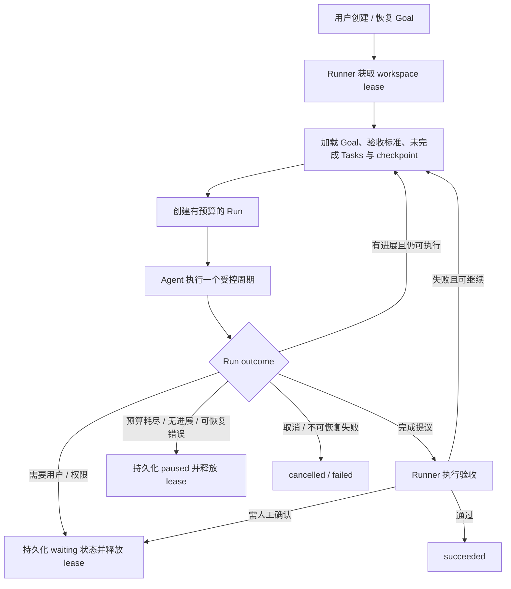

# Agent Goal：持久化目标执行

> **文档状态：已实现（2026-10-15）。** 本章描述当前源码提供的 Goal 生命周期、SQLite 持久化、bounded Runner、协议命令与 TUI 投影；仍未覆盖的高级能力在文末单独列出。

本章讨论 Tact 如何支持跨多个 turn、可暂停、可恢复、可监督并可验证完成的长期工作。设计建立在现有 [`TaskManager`](./19_chapter_persistent_tasks_zh.md)、[`agent_loop`](./18_chapter_agent_loop_zh.md)、SQLite session store、权限管理和 TUI 协议之上；它不是对某个 Agent CLI 的复刻，而是 Tact 自身的领域设计。

---

## 1. 核心定义与边界

Goal、Task、Turn 和 PlanStep 是不同层级，不能互相替代：

| 概念 | 职责 | 生命周期 |
|------|------|----------|
| **Goal** | 用户希望最终达成的结果，以及证明结果达成的验收标准 | 可跨 session、跨多个 run 持续；直到成功、失败或取消 |
| **Task** | 为 Goal 服务的可执行工作项、状态和依赖关系 | 由现有持久任务系统管理，可关联 Goal，也可独立存在 |
| **Run** | Runner 一次取得执行权后，对 Goal 的一次有预算的推进过程 | 有明确开始、结束、用量和结束原因；可被恢复或重试 |
| **Turn** | Agent 与模型之间的一次交互迭代，可能包含工具调用 | 属于 Agent loop；不是 Goal 的完成单位 |
| **PlanStep** | 当前执行过程的 UI 计划/步骤展示 | 临时显示状态，不承担跨进程持久化职责 |

核心规则：**Goal 是持久意图；Task 是工作图；Runner 是跨 turn 调度器；Agent 是在既有权限边界内工作的执行者；验收结果决定 Goal 是否成功。**

普通的一次性问题仍然是普通对话，不应自动创建 Goal。用户显式创建或确认 Goal 后，Goal 才进入持久化执行生命周期。

---

## 2. 用户可见行为

1. 用户通过 `UserCommand::CreateGoal` 或 `/goal create <objective>` 创建 Goal；交互式命令没有显式标准时会加入一个必需的人工作用标准。
2. Goal 被排入执行队列后，Runner 创建一次有预算的 Run，并让 Agent 检查现状、规划和维护关联 Task DAG。
3. 如果仍有可执行工作、没有用户阻塞且预算充足，Runner 可以启动下一执行周期；单次 `agent_loop` 正常结束只表示本次交互结束，不代表 Goal 完成。
4. 需要用户决定时，Goal 等待用户；需要权限时，继续使用现有权限流程，不推导或扩大授权。
5. Agent 认为目标已满足时，提交**完成提议**及证据，由 Runner 进入验证阶段。模型的完成文字、所有 Task 已完成或某个 turn 正常结束，均不是成功判据。
6. 自动验收通过后可标记成功；需要人工确认的标准由用户确认。验收失败则回到执行，预算耗尽或无法继续则暂停并说明原因。
7. 用户可查看、补充方向、暂停、恢复、取消或确认结果。对已结束 Goal 的重新执行必须是明确的用户操作，并留下事件记录。

当前命令表面：

```text
/goal list            列出当前工作区的 Goal
/goal create <text>   创建 Goal，文本同时作为标题和 objective
/goal show <id>       查看目标、标准、任务和验收摘要
/goal steer <id> <text> 补充方向或约束并写入事件
/goal pause <id>      暂停执行
/goal resume <id>     恢复执行
/goal cancel <id>     取消 Goal
/goal accept <id>     接受人工验收项 / 完成提议
```

这些命令映射为带 Goal ID 和用户文本的 typed `UserCommand`；list/show 在 Agent activation 进行时也直接从 `SharedGoalManager` 读取。

---

## 3. 生命周期与执行阶段

当前 Goal 状态：

```text
draft → queued → running → verifying → succeeded
                    │          │
                    ├─ waiting_user
                    ├─ waiting_permission
                    ├─ paused
                    ├─ failed
                    └─ cancelled
```

| 状态 | 含义 |
|------|------|
| `draft` | 目标和验收标准仍在确认，尚未授权 Runner 开始推进 |
| `queued` | 用户已确认，等待 Runner 获得执行 lease |
| `running` | Runner 持有 lease，Agent 正在推进工作 |
| `waiting_user` | 需要用户补充信息、决定方向或完成人工验收 |
| `waiting_permission` | 当前操作需要现有权限系统处理；无 UI 的环境必须暂停等待，不能等待不存在的 responder |
| `paused` | 用户暂停、预算耗尽、无进展保护或可恢复错误导致暂停 |
| `verifying` | Agent 已提交完成提议，必需验收项正在核验 |
| `succeeded` | 所有必需验收条件均有有效证据并通过 |
| `failed` | 已确认无法继续且 Goal 以失败结束；暂时性错误不应直接记为失败 |
| `cancelled` | 用户明确取消，或确认终止 Goal |

`phase` 是独立字段，用于显示当前 `planning`、`execution` 或 `verification` 阶段；不要将 phase 与生命周期状态塞进同一个枚举。

每次 Run 结束都带明确 outcome，而不是让 driver 从 `Result<()>` 或最后一段模型文字猜测：

```text
progress_made | needs_user | needs_permission | completion_proposed
budget_exhausted | no_progress | cancelled | transient_error | fatal_error
```

Runner 根据 outcome、任务图、验收状态和预算决定状态转移。暂停、等待和 run 结束都要先落库，再通知 UI。

---

## 4. 持久化模型

Goal 数据与会话 transcript 分开：transcript 记录对话事实；Goal 表记录当前可查询的结构化状态；事件表保留审计轨迹。领域记录沿用同一个工作区的 `.tact/tact.db`。

实际存储采用「**整行 JSON + 少量索引列**」：领域结构体（含标准、证据、预算用量、checkpoint）序列化进 `data` 列，查询和排序只依赖几列不变量。进化领域字段不需要迁移；契约稳定的是聚合语义与索引列。

### `goals`

```text
id TEXT PRIMARY KEY, data TEXT NOT NULL,
status TEXT NOT NULL, version INTEGER NOT NULL, updated_at INTEGER NOT NULL
```

索引：`idx_goals_status`、`idx_goals_updated_at`。

`data` 是 `Goal` 聚合的序列化：标题、objective、约束、phase、session 关联、完成时间与摘要，以及**验收标准列表**——每条标准含描述、`required`、`verification_kind`、`status` 和带 `criteria_version` 标签的证据。标准随聚合整体提交，`version` 即标准/证据版本号：用户修改目标或标准时递增，旧版本证据自动失效。CRUD 路径经 `GoalManager`，不允许绕过它直写。

Goal 属于工作区，不只属于创建它的 session。创建 session 与当前执行 session 分开记录，允许用户在后续 session 中查看和恢复。

### `goal_criteria`（不存在独立的表）

标准不是独立表：它嵌在 `goals.data` 的聚合里，随版本号一起写入。这样证据失效只需比较 `criteria_version`，不存在「标准改了、证据还在旧表里」的分叉。

「交互式 `/goal create` 未提供标准时由 driver 加入一个必需的人工标准」就是往这个聚合里写一条 `Human` 标准。

### `goal_runs`

```text
id TEXT PRIMARY KEY, goal_id TEXT NOT NULL, data TEXT NOT NULL,
state TEXT NOT NULL CHECK (state IN ('running', 'completed', 'interrupted')),
started_at INTEGER NOT NULL, finished_at INTEGER, stop_reason TEXT
```

索引：`idx_goal_runs_state`、`idx_goal_runs_goal_id`、`idx_goal_runs_started_at`。

`data` 是 `GoalRun` 记录：outcome、`turns_used` / `tool_calls_used` / `elapsed_ms` / `tokens_used`、checkpoint 和结束原因。Run 记录一次 lease 周期和资源消耗。进程异常退出时可以将过期的活动 Run 标为 `interrupted`，并在创建新 Run 时保留关联关系，不覆盖旧记录。

### `goal_events`

```text
seq INTEGER PRIMARY KEY AUTOINCREMENT,
id TEXT NOT NULL UNIQUE, goal_id TEXT NOT NULL,
data TEXT NOT NULL, occurred_at INTEGER NOT NULL
```

索引：`idx_goal_events_goal_seq`（`goal_id, seq`）——按 Goal 取区间事件。

追加式事件日志：创建、用户修改目标或标准、状态转移、Task 关联、Run 开始/结束、验收结果、steering、恢复、取消等。`seq` 保证全局顺序。事件用于诊断和审计；不能只依赖内存队列或 TUI 收到过的事件来恢复状态。

### `goal_leases`

```text
singleton INTEGER PRIMARY KEY CHECK (singleton = 1),
owner TEXT NOT NULL, epoch INTEGER NOT NULL, expires_at INTEGER NOT NULL
```

工作区内**单行** lease：`singleton = 1` 由 CHECK 约束保证只能有一个写入者。`epoch` 是递增的 fencing 代，所有状态写入必须携带当前 epoch。

### Task 关联

现有 `tasks` 表增加可空 `goal_id`，并建 `idx_tasks_goal_id_id` 索引。既有 Task 不需迁移出虚构 Goal；没有 `goal_id` 的任务继续照常工作。任务依赖仍由现有 DAG 管理。

Goal 生命周期更新、Run outcome 写入和事件追加应在可行时使用同一 SQLite 事务，避免 UI 看见已暂停但 run 仍显示活跃等不一致状态。迁移必须幂等，兼容已有数据库。

---

## 5. Runner 与 Agent 主循环

`GoalRunner` 属于 session/command driver 的编排层，不属于 `Agent::agent_loop` 内的无限循环：



Agent loop 仍负责单次模型交互、工具 dispatch、hooks、权限、会话消息与 compaction。Goal 模式额外返回显式的 yield outcome；普通对话维持原有任务语义。

每个新周期开始时，Runner 注入精简且权威的 Goal 上下文：目标、硬约束、验收标准摘要、关联 Task 状态、最近 checkpoint 和暂停原因。完整事件历史按需查询，不应每轮无界地注入 prompt。上下文应以明确标签与边界传递，不能让来自历史/tool output 的内容覆盖用户约束。

Agent 可报告 checkpoint、提出 Task 变更、请求用户输入、请求权限或提交完成提议；Goal 状态的最终写入权归 Runner/GoalManager。Subagent 可继承只读 Goal 摘要；只有明确委派的任务可以在父 Goal 范围内推进，子 Agent 不得直接结束或重开 Goal。

---

## 6. 验收：成功必须有证据

- Goal 启动前应有可检查的必需验收标准；交互式 `/goal create` 未提供时由 driver 加入默认人工作用标准，API 调用者可直接提供标准。
- 自动验收由 Runner 调用已有安全工具/权限体系执行；Goal 不提供绕过 permission manager 的“可信命令”通道。
- 人工验收由用户显式确认，并记录确认者、时间及针对的标准版本。
- Agent 提交完成提议后进入 `verifying`。Runner 检查所有 `required = true` 的标准是否通过，且证据与当前 Goal/标准版本匹配。
- 全部必需自动检查通过且没有待确认标准，才可自动转为 `succeeded`。
- 有人工标准时转为 `waiting_user`；用户接受后成功，拒绝后将反馈带回 `running`。
- 验收失败时回到 `running` 修复；预算耗尽则转 `paused` 并列出失败项。不得把“任务清单清空”当作验收通过。
- 用户修改目标或验收条件时提升版本号；旧版本的证据不能默认为新版本通过，必须按影响重新验证。

---

## 7. 预算、并发与恢复

### 预算与进展保护

每次 Runner activation 有 turn、墙钟时间和工具调用上限。当前默认值为 24 turns、60 次工具调用和 600 秒墙钟时间；达到上限后保存 checkpoint、用量和 stop reason，进入 `paused`。这些限制由 `GoalLimits` 集中定义。

无进展检测应依赖可观察变化，例如 Task 状态、验收证据、有效 checkpoint 或工作树差异，而不只依赖模型自述。连续若干周期无可观察进展时暂停并向用户报告；单次失败或偶发网络错误不应立即判定 Goal 失败。

### Lease 与写入隔离

同一执行目录默认只允许一个写入型 Goal Runner。lease 应包含 owner、过期时间/心跳和递增 fencing epoch；所有状态写入校验当前 epoch，避免旧进程失去 lease 后继续提交覆盖新执行者的结果。独立 worktree 可按独立执行目录并发；是否允许多个 Goal 对同一目录并行写，首版默认禁止。

### 崩溃恢复与取消

- 启动或恢复时先检查活动 Run 与 lease；lease 过期后将旧 Run 标记为 `interrupted`，然后创建新的恢复 Run。
- 恢复以 SQLite Goal/Run/Event 状态和 session transcript 为依据，不依赖进程内 future、channel 或 pending queue。
- 只有完成幂等性检查后才重试可能已执行但结果未落库的操作；外部副作用不得因为恢复而盲目重放。
- 取消先持久化取消请求，再触发当前 Agent 的 `cancel_flag`；等待活动工具按现有取消语义退出，记录 Run 终态并释放 lease。
- 进程退出或 TUI 断开不能把 Goal 静默标成成功；无 UI 时遇到用户决策/权限需求应暂停并可由后续 session 恢复。
- 挂起的权限请求不能在进程重启后被视为已批准；恢复时须重新经过当前权限流程。

---

## 8. 权限与安全边界

Goal 授权的是“持续尝试达成这个目标”，不是对将来所有副作用的预先批准：

- 文件写入、shell、MCP、网络和敏感路径访问继续由现有权限系统及安全扫描器控制。
- Goal 验收命令也走相同的工具和权限路径；验收配置不能执行任意 shell 绕过审批。
- 用户 steering、目标变更、标准变更和人工验收必须作为用户来源事件记录；不能让模型工具伪造用户确认。
- Goal 工具只允许访问当前执行上下文中的 Goal；Task 关联也默认限定在该 Goal，避免跨 Goal 修改。
- 工具结果和恢复 checkpoint 可能包含不可信内容，重新注入时保留来源标签和信任边界。
- Runner 负责取消、预算、lease 和调度；它不更改现有 permission mode，也不静默降低审批要求。

---

## 9. TUI / Headless 协议

TUI 使用 `AgentUpdate::GoalsChanged` 携带完整 `GoalSnapshot` 集合，并通过 `UserCommand` 的 `CreateGoal`、`ListGoals`、`ShowGoal`、`SteerGoal`、`PauseGoal`、`ResumeGoal`、`CancelGoal` 和 `AcceptGoal` 控制生命周期。快照包含状态、phase、标准摘要、Task 进度、等待原因、预算和验收计数；重新连接或恢复时仍以 SQLite 为权威来源。

Goal 面板可以接入现有 Tasks / Subagent / Background sticky host，概览显示：目标标题、Goal 状态与 phase、当前 Run、关联 Task 进度、阻塞原因、预算用量和验收摘要。展开视图提供标准逐项状态、证据、最近事件和暂停/恢复/取消/确认操作。

Headless 与交互式模式共用同一个 GoalRunner 和状态机。Headless 遇到必须由用户决定的事项时保存 `waiting_user` 并退出当前 Run，不能等待 UI responder；后续通过命令或 API 补充输入后恢复。

---

## 10. 实时代码边界

当前代码地图：

| 路径 | 职责 |
|------|------|
| `crates/tact/src/goal/` | `Goal`、标准、证据、状态机、`GoalManager`、`GoalVerifier` |
| `crates/tact/src/store/goal_store/` | `GoalStore` trait、SQLite schema、事务、lease 与事件持久化 |
| `crates/tact/src/task/`、`store/task_store/` | Task 可选 `goal_id`、Goal 范围查询及旧记录兼容 |
| `crates/tact/src/tool/` | 注入 `SharedGoalManager`；Goal 感知工具与受限 Task 作用域 |
| `crates/tact-ui/src/session_bootstrap.rs` | 为 Agent 构建并注入共享 Goal manager |
| `crates/tact-ui/src/goal_runner.rs`、`driver.rs` | bounded activation、预算、lease、恢复、命令串行化 |
| `crates/protocol/src/agent.rs` | Goal 快照、`GoalsChanged` 和用户命令协议 |
| `crates/tui/`、`crates/agent_tui_kit/` | Goals sticky panel、状态投影、鼠标切换与背景测试 |
| `book/`、`docs/superpowers/` | 本设计章节与实现前 spec/plan；代码交付时同步实际行为 |

实现为迁移、状态机合法转移、lease/fencing、Run 预算、验收证据、无 UI 等待、取消及崩溃恢复提供了聚焦测试。跨 channel 等待的异步测试使用 timeout；Cargo 验证必须串行运行。

---

## 11. 与现有领域的关系

- [第 1 章 Store](./01_chapter_store_zh.md)：Goal、Task、Run、事件和 session transcript 共用工作区 SQLite，但各有明确领域边界。
- [第 10 章权限](./10_chapter_permission_zh.md)：Goal 不改变风险分级、审批模式或敏感路径守卫。
- [第 18 章 Agent 主循环](./18_chapter_agent_loop_zh.md)：`agent_loop` 仍是单次执行内核；Goal 跨周期调度由外层 Runner 负责。
- [第 19 章持久任务](./19_chapter_persistent_tasks_zh.md)：Goal 关联既有 Task DAG，不替代独立任务。
- [第 23 章 TUI](./23_chapter_tui_zh.md) 与 [第 25 章协议](./25_chapter_protocol_zh.md)：Goal UI 是协议驱动的投影；持久 store 才是恢复依据。
- [第 26 章工程问题日志](./26_chapter_issue_zh.md)：Goal 的交付记录见 2026-10-15 条目。

## 12. 当前限制

- `/goal create` 的文本命令只提供默认人工作用标准；复杂的自动标准仍需通过 API/领域层创建。
- 当前协议提供完整 Goal 集合快照，没有单独的 `GoalRunChanged` 增量事件；运行预算在活动 run 中展示，完成 run 的详细审计保存在事件表。
- Goal sticky panel 提供状态、预算、Task 进度、验收摘要、等待原因和标准列表；具体标准操作仍通过 `/goal accept` 等命令完成。

---

## 相关文档

- [书籍目录](./index_zh.md)
- [存储与持久化](./01_chapter_store_zh.md)
- [权限模型](./10_chapter_permission_zh.md)
- [Agent 主循环](./18_chapter_agent_loop_zh.md)
- [持久化任务管理器](./19_chapter_persistent_tasks_zh.md)
- [TUI 与 Agent–TUI 协议](./23_chapter_tui_zh.md)、[第 25 章](./25_chapter_protocol_zh.md)
