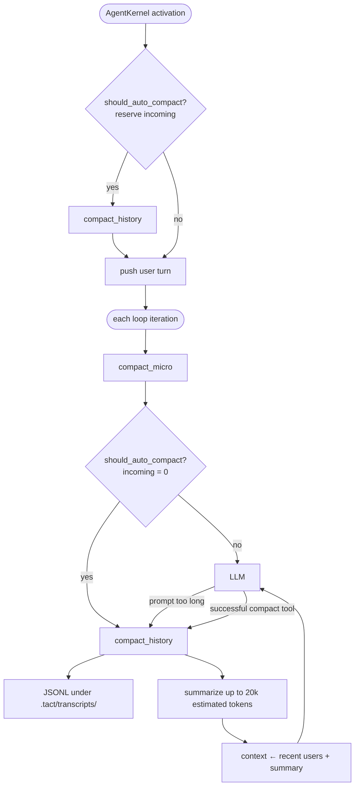

# Context Compaction

Companion notes for tuning and quick reference. For the full interactive walkthrough (diagrams, loop ordering, envelope vs stub), see **[book/05_chapter_compact_zh.html](../book/05_chapter_compact_zh.html)**.

tact implements **three-tier progressive compaction**:

| Tier | Trigger | Target | Strategy |
|------|---------|--------|----------|
| Tier 1: Large Output Persist | Any successful native/MCP output > 30K chars | One tool result | Write to disk, keep `<persisted-output>` preview |
| Tier 2: Micro Compaction | Before each LLM call | Old tool results | Stub (keep last 12; only if > 120 chars) |
| Tier 3: Full Compaction | Reported/estimated input reaches 80% of the window, prompt-too-long, or `compact` tool | Conversation history | JSONL transcript + LLM summary → retained real users + handoff |

> **OpenAI Responses providers do not use the local Tier-3 summary path.** Ordinary
> `/responses` requests carry `context_management` with the resolved compact
> threshold, and `compact_history` calls the native `POST /responses/compact`
> endpoint, replacing the opaque protocol baseline (never the logical context).
> Endpoints without native compaction are unsupported — no local-summary
> fallback. See [book/05_chapter_compact_zh.html](../book/05_chapter_compact_zh.html).
> The Responses wire baseline is retained as raw JSON. Known items are
> normalized for Tact content, while unknown input/output items are preserved
> and replayed on the next request instead of being silently dropped.



---

## Tier 1: Large Output Persist

**Trigger**: any successful native or MCP tool result exceeds `PERSIST_THRESHOLD` (30,000 characters), **except `read_file`**. `read_file` already returns a line/token-bounded page (default 2,000 lines / ~25k approx tokens) with an explicit `[PARTIAL view …]` continuation marker, so dispatch skips `persist_large_output` for that tool.

**Process**:
1. Full output → `.tact/tool-results/{tool_use_id}.txt`
2. Context keeps a tagged envelope with path + first `PREVIEW_CHARS` (2,000) characters

```xml
<persisted-output>
Full output saved to: .tact/tool-results/abc123.txt
Preview:
[first 2000 characters...]
</persisted-output>
```

**Why the tags**: For the model, not runtime parsing. Marks a system envelope so metadata is not mistaken for stdout; full text is recoverable via `read_file`. Distinct from the micro-compact stub (older history), which uses `[Earlier tool result compacted. …]`.

| Constant | Default | Location |
|----------|---------|----------|
| `PERSIST_THRESHOLD` | 30,000 | `compact/mod.rs` |
| `PREVIEW_CHARS` | 2,000 | `compact/mod.rs` |

Each artifact directory retains at most the 100 newest files after a write.

---

## Tier 2: Micro Compaction

**Trigger**: Before each model dispatch when the product context policy enables
`agent.micro_compact_enabled`.

1. Collect all `ToolResult` blocks (user messages), chronological order  
2. Keep the last `KEEP_RECENT_TOOL_RESULTS` (12) intact  
3. Older results with **> `MICRO_COMPACT_STUB_CHARS`** (120) characters → stub  

```
[Earlier tool result compacted. Re-run the tool (e.g., read_file) for full content.]
```

Short results stay (high density, low cost). Assistant / thinking / user text are never stubbed.

| Constant | Default |
|----------|---------|
| `KEEP_RECENT_TOOL_RESULTS` | 12 |
| `MICRO_COMPACT_STUB_CHARS` | 120 chars |

All three live in `runtime/compaction_adapter.rs`, the module that runs the
pass; `context_adapter.rs`'s `micro_compact_due` imports the same constants, so
the trigger check and the pass cannot disagree about when it is due. A
`const _` assertion keeps the stub shorter than the threshold it retires.

`compact::micro_compact()` — the pre-kernel implementation — was deleted in
`fix/compact-dead-micro-compact`: it had no caller since 84afab48.

---

## Tier 3: Full Compaction

**Triggers** (any of):
- **Entry**: before pushing the user turn, `should_auto_compact` with `incoming_turn` reserved
- **Each loop iteration**: after the micro pass, `should_auto_compact` with `incoming = 0`:
  - **Primary:** `last_token_total + estimate_message_tokens(incoming) >= 80% of agent.model_context_window` (default **200,000** tokens)
  - **Fallback / post-usage growth:** structured context + incoming tokens reaches the same 80% threshold. Text is estimated at ~4 ASCII chars/token and 1 token per non-ASCII character. Images use a fixed 1,600-token vision budget, never their base64-encoded length — an encoded screenshot is not a 30k-token text block.
  - **Responses exception:** the product context policy uses the provider-reported `last_token_total` only. The logical-context estimate is deliberately excluded because native compaction shrinks the wire baseline, not the logical context. An estimate-driven trigger would re-fire forever. No usage yet means no trigger.
- Provider prompt-too-long recovery ([Ch 6](../book/06_chapter_recovery_zh.html))
- Successful manual `compact` tool (after tool results are appended; failed invocations do not rewrite history)

### Steps

1. **`write_transcript`** (async) → unique `.tact/transcripts/transcript_{unix_nanos}_{collision}.jsonl`
2. **Recent window** — select from the tail within the model budget and a 20k estimated-token cap; oversized messages become valid text-only views and images become omission markers
3. **Summarize** — window-aware `create_message`: at most 2k **text** output tokens plus a reasoning bucket (`≤ 16k`) picked by a staged effort ladder (inherit → minimize → adapt from the observed `reasoning_tokens`), with output/headroom reserved. The whole envelope — text budget, reasoning reserve, and the `[agent] max_tokens` floor — is clamped to the model's `ModelCapabilities::max_output_tokens`, so a model with a low output cap never receives an over-limit request; transient failures retry up to five times; a truncated summary is continued up to five times and then accepted best-effort, while abnormal stop reasons and empty summaries fail without replacing context
4. **Replace** — Codex-style `[recent real User…] + [<context-handoff> summary cell]` (legacy: `compacted_context`); the handoff cell is a `User`-role message framed with `<context-handoff>` … `</context-handoff>` and marked `MessageKind::Summary` in memory (string fallback on reload); retained users reserve max output, system/tools/summary, and 20% headroom; block UI turns count as real users, tool-result-only blocks and injected-context cells (`<hook-context>`, the Goal runner's `<goal-context>`) are excluded, and base64 is never truncated; a final full-request guard reduces retained users until the request fits
5. **`replace_session_messages`** — SQLite matches the new context; message-id window reset; `last_token_total = 0`

### Recent files

`CompactState.recent_files`: last 5 paths from successful `read_file`, `write_file`, and `edit_file` calls (dedupe, LRU). Injected into the summarizer prompt and final summary.

---

## Lifecycle events

The kernel is the one component that sees every compaction transition, so it —
not each frontend — owns reporting them. `TactEventBridge` in
`crates/tact/src/runtime/event_adapter.rs` turns
`AgentEvent::Compaction(CompactionEvent)` into
`AgentUpdate::Compaction(CompactionEvent)`, and every host renders from that:

| Event state | Emitted when | Carries |
|---|---|---|
| `Started` | `compact_state` begins, right after the `[auto compact]`-style notice | `kind` |
| `Completed` | the replacement was persisted and committed | `kind`, `summary` |
| `Failed` | the context policy or the commit failed | `kind`, `error` |
| `Cancelled` | a `PreCompact` hook vetoed it, nothing needed compacting, or the activation was cancelled | `kind`, `reason` |

`CompactionEvent` lives in `tact_agent_api::context` and is a closed enum, so a
new state cannot be added without every consumer deciding what to draw.

Two notes for anyone adding a consumer:

- **The summary travels on the replacement.** `ContextReplacement.summary` is
  set by the context policy (`None` for native Responses compaction, which keeps
  its summary provider-side) and copied into the `Completed` event. Reading
  `compact_state.last_summary` instead would not work: the kernel emits the
  event, that field is facade state written by `compaction_committed`, and the
  policy's return value is the only place both halves of a compaction agree.
- **The `Info` lines stay.** `[auto compact]`, `[compact summary 1/6]`, and
  `Compaction complete (Auto).` are what the TUI and the desktop render. The
  typed event is a second view of the same fact, not a replacement — dropping
  the text would blank log rows users already read. The completion line is
  written only for a `Completed` state: `compact_history` returns the
  `CompactionOutcome`, so `/compact` says `Nothing to compact: <reason>` when
  a `PreCompact` hook vetoed it or the context held nothing to compact,
  instead of claiming a success the card next to it contradicts.

Clients that draw a progress card follow the typed event. ACP is the only one
today: `crates/tact-acp` maps the four states onto `compaction_update` and
keeps one `compaction_id` for the whole compaction (see
[crates/tact-acp/README.md](../crates/tact-acp/README.md#compaction)).

---

## Configuration

| Setting | Default | Effect |
|---------|---------|--------|
| `agent.model_context_window` | 200,000 | Token window: auto Tier-3 trigger at 80% + TUI usage meter; `0` means the host has no known window and disables window-based triggering; nonzero values must exceed `max_tokens`. The stable `ModelCapabilities` boundary uses `None` for unknown, never a zero sentinel. |
| `agent.micro_compact_enabled` | `false` | Tier-2 stub pass — **opt-in**. `true` in TOML or `--micro-compact` enables it; `--no-micro-compact` forces it off and beats both. The two flags conflict. The default is `AgentSettings::DEFAULT_MICRO_COMPACT_ENABLED`, shared with the desktop settings view so the switch cannot describe a pass the engine will not run. |

Breaking rename from `context_limit_chars` / `--context-limit-chars` — **no silent alias**.

Compile-time: 12 / 120 / 30k / 2k / 20k summary-input and retained-user tokens / 100 artifacts are not configurable yet.

---

## Integration with System Prompt

```
If a tool result was truncated and you need the details, re-run the relevant tool (e.g., read_file)
```

---

## Gaps (short)

- Cold-start token estimation remains heuristic (ASCII ~4 chars/token, non-ASCII 1 char/token); the TUI still uses a simple `used/window` meter without Codex baseline/effective-window math; fixed thresholds are compile-time constants.

### Micro Compact

- **Model memory loss**: truncated tool results vanish from context; model may fabricate if it misses the stub
- **False context mismatch**: diff/patch operations fail when model doesn't re-read truncated content
- **Crude selection**: recency+length only (keep last 12, stub > 120 chars) — a critical file at position 13 is lost while trivial `ls` outputs at positions 1–12 survive
- **Prefix cache pollution**: on auto-caching models (OpenAI, DeepSeek), stub replacement invalidates the cached prefix, causing a cache miss on every truncated result. See [OpenAI Prompt Caching](https://platform.openai.com/docs/guides/prompt-caching), [DeepSeek KV Cache](https://api-docs.deepseek.com/guides/kv_cache). Claude ([docs](https://docs.anthropic.com/en/docs/build-with-claude/prompt-caching)) is less affected — its explicit `cache_control` breakpoints sit before tool results

### Planned optimizations

| Idea | Priority |
|------|----------|
| Context-window-gated trigger (e.g., only run when > 50% of window is used) | High |
| Selective tool truncation (exempt already-bounded `read_file` pages; keep their outputs) | High |
| Semantic importance scoring (keep results referenced in later turns) | Medium |
| Configurable thresholds (runtime instead of compile-time constants) | Low |
| Stub-aware prompt (better guidance to trigger re-reads consistently) | Medium |

See the book chapter (§11) for the full list.
