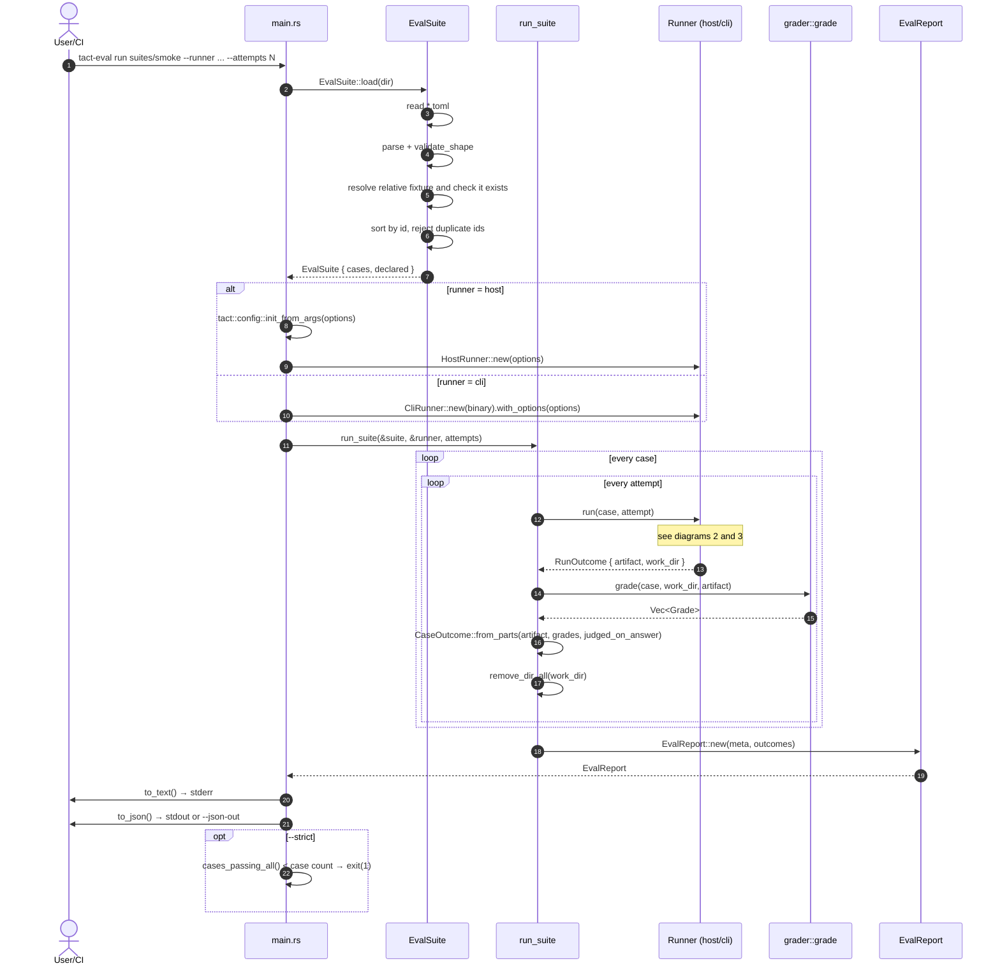
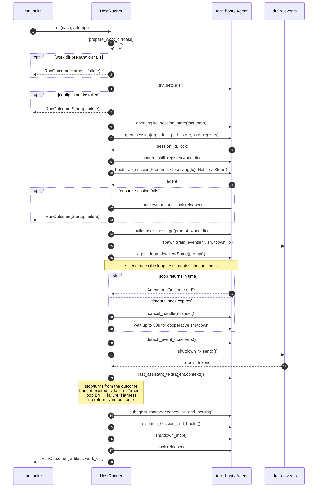
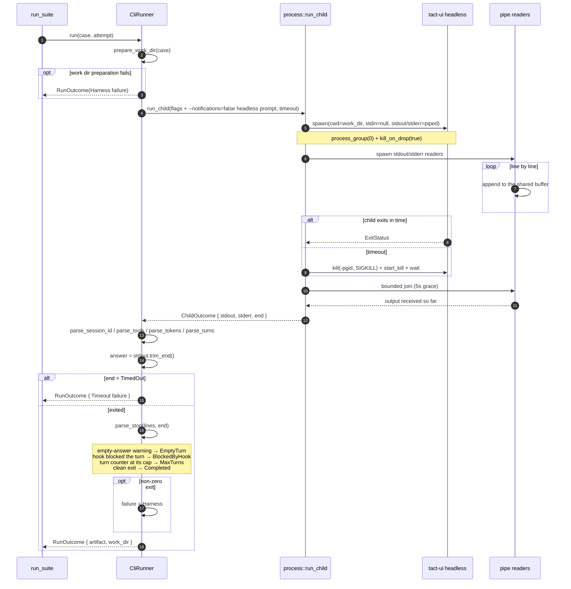
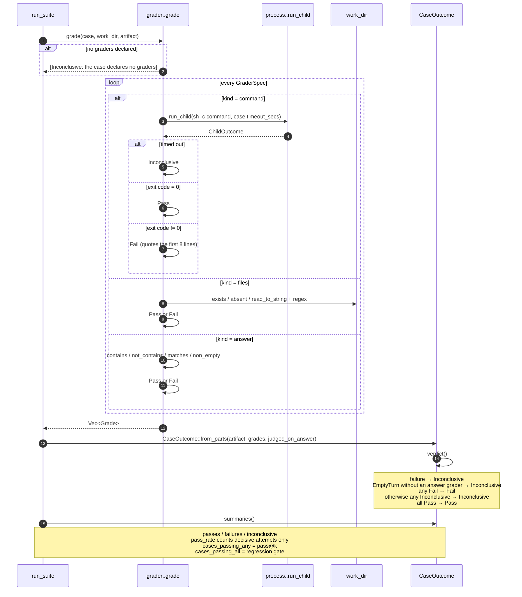

# Agent evaluation: sequence diagrams

Companion to [`agent-eval.md`](agent-eval.md). The four diagrams below trace one
`tact-eval run` from suite loading to the report, then split the two runners and
the grading fold into their own views. They follow the current source, so code
references are included for the parts most likely to move.

## 1. Suite orchestration (`run_suite`)

- `crates/eval/src/main.rs:109-139`: load, configure, run, print.
- `crates/eval/src/lib.rs:47-89`: sequential cases, grade after each attempt,
  delete the work directory.
- `crates/eval/src/suite.rs:28-62`: loading, fixture resolution, ordering.

## 2. HostRunner: one attempt in process

- `crates/eval/src/host_runner.rs:69-243`: bootstrap, loop, teardown.
- `crates/eval/src/host_runner.rs:252-277`: the event pump stops on a signal,
  not on the channel closing, because a detached background task can hold a
  sender forever.
- The typed stop reason and turn count come from `agent_loop_detailed`; they
  never cross a process boundary.

## 3. CliRunner: one attempt as a child process

- `crates/eval/src/cli_runner.rs:84-160`: spawn, parse, infer the stop reason.
- `crates/eval/src/process.rs:58-133`: process group, timeout kill, bounded
  pipe drain.
- The stderr contract is mirrored by hand from `headless_log.rs`; anything the
  parsers cannot attribute stays unattributed rather than guessed.

## 4. Grading fold and summary

- `crates/eval/src/grader.rs:41-108`: one grade per declared grader.
- `crates/eval/src/report.rs:85-113`: the single place that decides an attempt.
- `crates/eval/src/report.rs:157-195`: per-case rollup, pass@k, and the strict
  gate.

The diagrams render in any Markdown viewer that supports Mermaid, including
GitHub.
